# F_Agent — 30年期国债期货智能量化策略系统

[](https://www.python.org/)
[](https://lightgbm.readthedocs.io/)
[](https://pytorch.org/)
[](https://streamlit.io/)
[](https://plotly.com/)
[](https://akshare.akfamily.xyz/)
[](https://optuna.org/)
[](https://www.deepseek.com/)
[](https://www.trychroma.com/)

面向 TL（30年期国债期货）的金融研究系统，整合因子挖掘、版本化策略、研究证据与债券舆情监控。当前权威链路使用统一 SignalPolicy 和模型发布门禁；舆情、RAG、Jev、LLM 均为研究影子层，不下单、不改仓位，旧增量 AdapterStack 已退役。

最新使用入口：[TL运行与发布手册](docs/tl_agent_operations.md) · [债券舆情监控 Agent 配置指南](docs/bond_sentiment_agent.md) · [混合决策框架调研与使用](docs/hybrid_decision_research_2026-10-03.md)。下面的历史架构说明尚未全部同步，以这些文档及当前代码为准。

新增：[混合研究准备与候选验收](docs/hybrid_preparation.md)。前端提供只读就绪检查、本地因果因子候选、独立模型训练（不发布）和已保存候选读取。`--mode readiness / prepare-factors / train-candidate` 将准备与发布拆开；候选来源、输入哈希、标签分区及门禁结果可追溯。当前真实候选未通过封存集与策略门禁，未启用生产模型或实盘。

下一阶段已接入：[分钟数据导入与覆盖审计](docs/minute_data_pipeline.md)。CSV 默认只读校验，确认后保存独立批次；显式选择并组装分钟快照，再用 `prepare-factors --minute-snapshot` 构建因子。原始数据真实审计发现 335 个不完整合约日，前端可下载待核对范围；未宣称历史缺口已补齐。

来源适配已补充：[天勤 CSV 与新浪近期窗口](docs/minute_source_adapters.md)。天勤导出离线保留原文、精确核对纳秒并重放转换；公开近期行情必须显式联网，默认未知语义仅预览，另行确认才能保存独立批次。无后台轮询或自动训练。

主界面已分层：[研究工作台导航与验收](docs/workspace_ui.md)。首页只展示状态与常用入口；左侧导航分为总览、市场与舆情、混合研究、因子实验室、数据与模型、回测与复盘、系统设置。每次仅渲染当前功能，行情默认读缓存。数据接入/训练已从研究页面移出，连接配置移至系统设置。

前端「混合决策工作台」使用统一研究入口：已发布量化模型与证据检索 → Jev 路由/语义判断 → LLM Researcher → Advisor → 确定性风险检查与保守影子结论。页面展示同一运行的时点、来源、模型、阶段状态、证据引用与分歧；默认离线，不下单、不覆盖基础策略。在线服务需显式开启；缺失已发布模型、陈旧因子会明确阻断，不生成演示信号。

```bash
# 离线诊断，不重建因子、不采集情报、不保存审计产物
.venv/bin/python src/main.py --mode hybrid --network-mode offline --no-persist
```

```bash
# 抓取东方财富、央行及财政部公开债券情报，不调用模型、不外发消息
.venv/bin/python src/main.py --mode monitor --no-llm
```

---

## 系统架构

```
┌──────────────────────────────────────────────────────────┐
│                     Data Pipeline                         │
│    AKShare → 分钟行情 · Tick快照 · 宏观数据 · 研报           │
└───────────────────────┬──────────────────────────────────┘
                        ↓
┌──────────────────────────────────────────────────────────┐
│                   Factor Engine (151维)                    │
│   动量·波动率·微观结构·量价·技术·基差·宏观·增强因子            │
│   ┌───────────────────────────────────────────────┐      │
│   │ 制度自适应因子 (34): OI增长率·波动率突破·ADX·流动性  │      │
│   └───────────────────────────────────────────────┘      │
└───────────────────────┬──────────────────────────────────┘
                        ↓
┌──────────────────────────────────────────────────────────┐
│              CNN 时序卷积 (Bottleneck Embedding)           │
│   25微观特征 × 30bar窗口 → 1D Conv → 64维稠密嵌入          │
│   作为"学习到的微观因子"注入 df_factors.pkl                 │
└───────────────────────┬──────────────────────────────────┘
                        ↓
┌──────────────────────────────────────────────────────────┐
│               LightGBM 双模型 (155特征)                     │
│   Base Model (200树,d=3) + HighVol/Trend Model (200树,d=4) │
│   12-Month Rolling Window + 90d Time Decay                 │
└───────────────────────┬──────────────────────────────────┘
                        ↓
┌──────────────────────────────────────────────────────────┐
│           甜点区排名信号 (Sweet Spot Ranking)               │
│   做空甜点区: rank 15%-30%  (准确率 72.7%)                  │
│   做多甜点区: rank 70%-85%  (准确率 63.6%)                  │
│   跳过: 0-15% 极端区 + 85-100% 噪声区                       │
└───────────────────────┬──────────────────────────────────┘
                        ↓
┌──────────────────────────────────────────────────────────┐
│   候选回测 + Gate Attestation + ReleaseManager            │
│   哈希绑定并原子切换 current.json；旧 AdapterStack 已停用    │
└───────────────────────┬──────────────────────────────────┘
                        ↓
┌──────────────────────────────────────────────────────────┐
│            研究工作台 · 七区导航 / 按需加载                 │
│   信号·监控·因子·因评·回测·宏观·AI·RAG·记忆·迭代·评估·调参·调度·微调   │
└──────────────────────────────────────────────────────────┘
```

---

## 受控模型迭代架构

```
                    ┌─────────────────────────────────┐
                    │  ① Point-in-time 特征与研究特征    │
                    │  宏观慢变量 + 微观快变量 + 可选CNN  │
                    └──────────────┬────────────────────┘
                                   ↓
                    ┌─────────────────────────────────┐
                    │  ② 候选训练 + 同策略成本后回测      │
                    │  schema / 时间 / 收益 / 风险门禁     │
                    └──────────────┬────────────────────┘
                                   ↓
                    ┌─────────────────────────────────┐
                    │  ③ ReleaseManager 原子发布         │
                    │  manifest + 哈希 + gate attestation │
                    │  ModelRuntime 只读 managed release  │
                    └─────────────────────────────────┘
```

### ① CNN 瓶颈嵌入

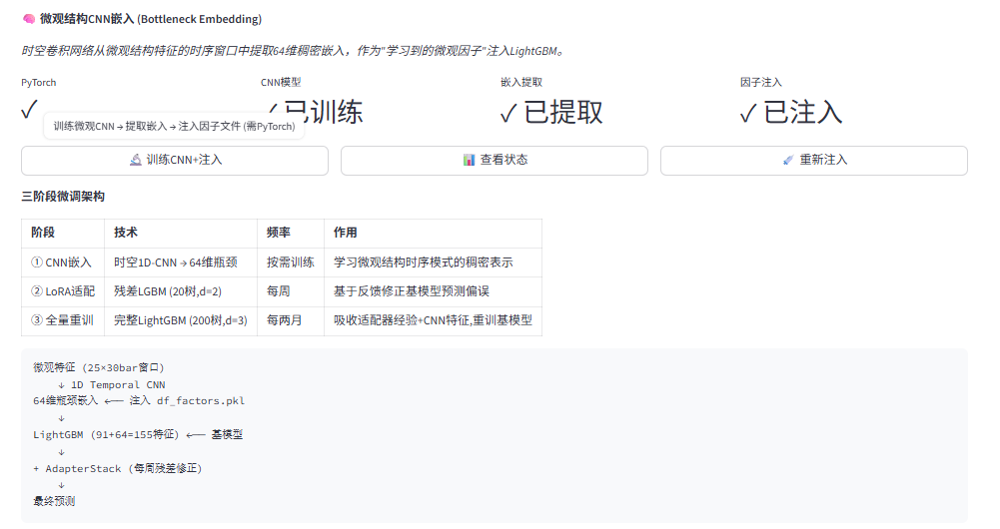

类比订单簿 CNN（10档×4特征 → 2D Conv → Bottleneck），受限于 L1 盘口数据，采用**时序卷积**补偿深度维度：

| 原始设想 | 适配方案 |
|:--|:--|
| 10档盘口 × 4特征 → 2D CNN | 30bar 滑动窗口 × 25 微观特征 → 1D Temporal CNN |
| 学习空间结构（深档托盘） | 学习时间结构（spread扩张→volume surge→imbalance反转模式） |
| 64维瓶颈嵌入 → LightGBM | **完全一致** |

```
输入: (batch, 25 features, 30 bars)
  ↓ Conv1D(32, k=5) + BN + ReLU
  ↓ Conv1D(64, k=3) + BN + ReLU
  ↓ Conv1D(64, k=3) + BN + ReLU
  ↓ GlobalAveragePool
  ↓ Dropout(0.5) → Dense(128) → Dense(64) ← 瓶颈嵌入 (注入LightGBM)
  ↓ (训练时) Dense(1) → 30min forward return
```

### ② 旧 AdapterStack（已停用）

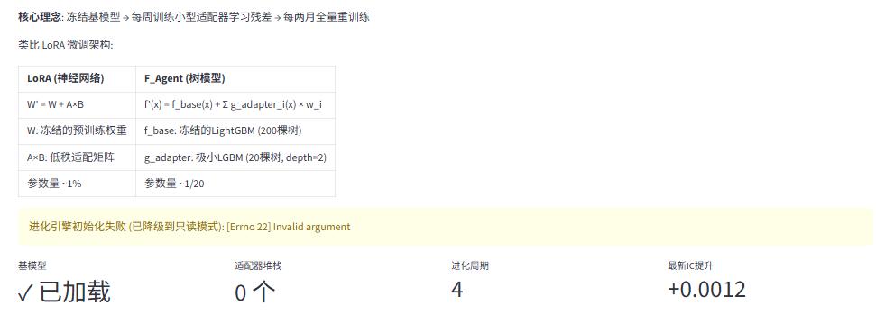

该实验路径直接反序列化并覆盖 `adapter_stack.pkl`，没有统一候选清单、哈希绑定和
回测门禁，现已默认且不可配置地停用。遗留文件只做存在性展示，不会自动读取、
移动、删除或参与预测。所有模型更新统一使用 `python main.py --mode train`。

---

## 核心功能 (14个面板)

### 第一行

| 面板 | 功能 | 截图 |
|:--|:--|:--|
| **📡 信号看板** | 实时排名信号 + 预测走势图 + 甜点区标注 + 绩效快照 | 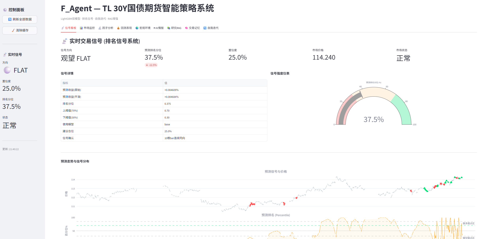 |
| **📊 市场监控** | 多分辨率K线(1min~日) + 市场状态着色 + 成交量分布 | 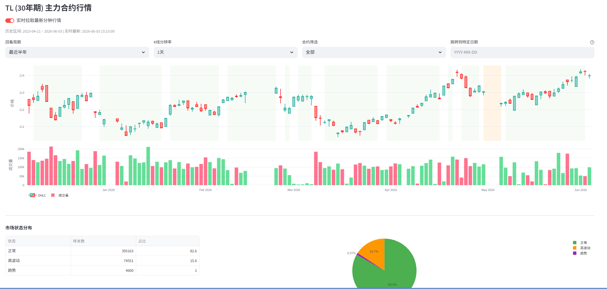 |
| **🔬 因子分析** | Top15特征重要性 + 分位异常预警 + 特征历史分位图 | 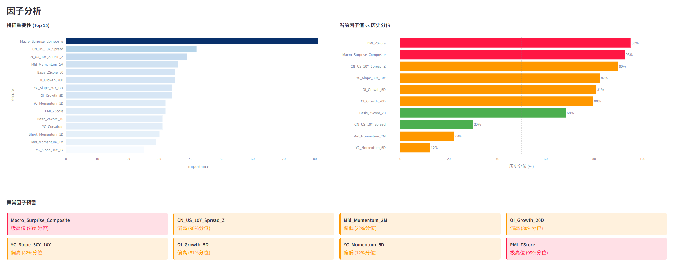 |
| **🔍 因子评估** | Alphalens风格 IC排名 + 稳定性散点图 + Spearman热力图 | 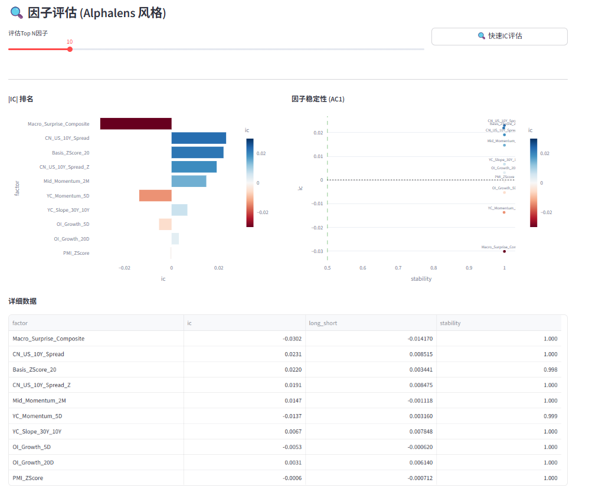 |
| **💰 回测表现** | NAV曲线 + 回撤分析 + 日收益分布 + 分状态收益 | 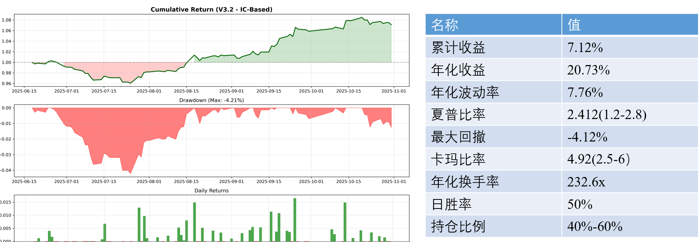 |
| **🌍 宏观环境** | 收益率曲线形态 + 中美利差历史 + 宏观指标趋势 | 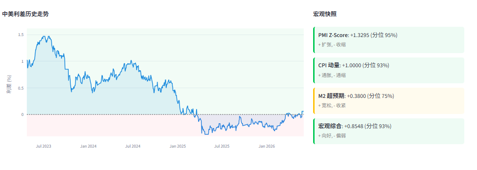 |
| **🤖 AI情报** | DeepSeek 债券新闻分析 + 量化数据交叉验证 | 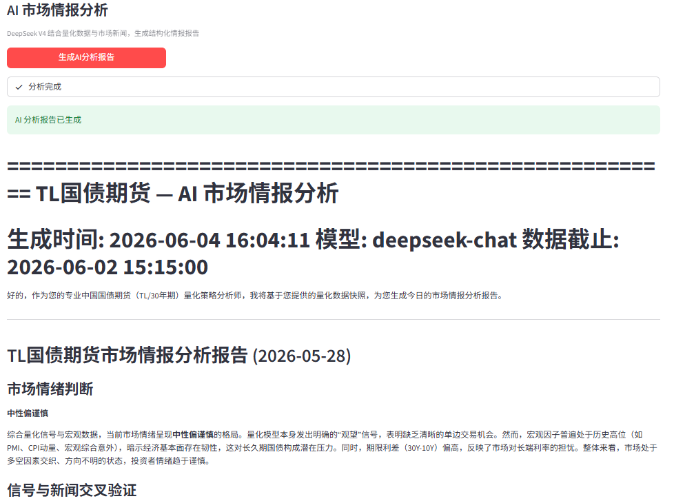 |

### 第二行

| 面板 | 功能 | 截图 |
|:--|:--|:--|
| **📚 研究RAG** | ChromaDB检索 + 央行报告/中金所月报/研报语义搜索 + AI简报 | 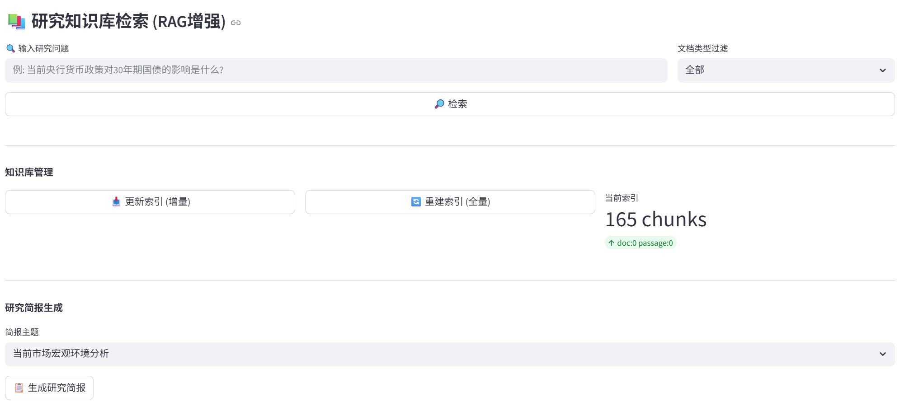 |
| **🧠 交易记忆** | 准确率矩阵 + 状态×方向交叉分析 + LLM归因反思 | 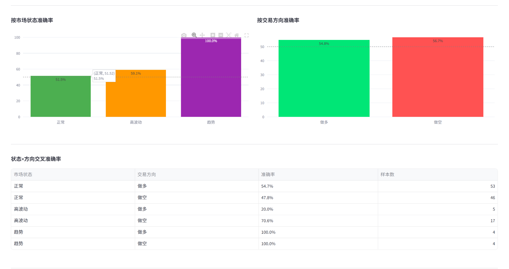 |
| **🔄 自我迭代** | 滚动IC监控 + 制度漂移检测 + 时间衰减加权 + 参数自动调优 | 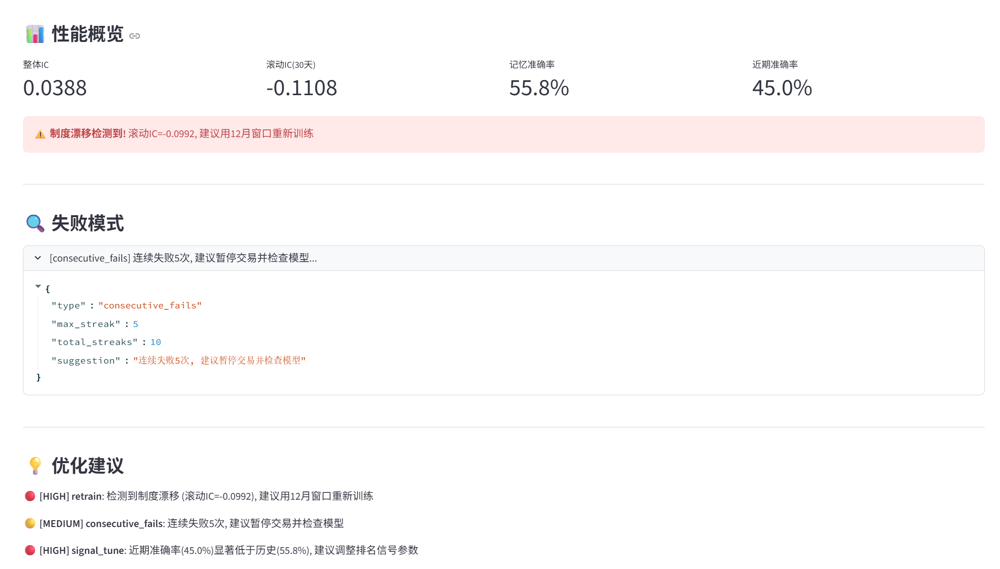 |
| **📋 模型评估** | 滚动窗口IC + 基线对比 + 退化检测 + 滚动IC趋势图 | 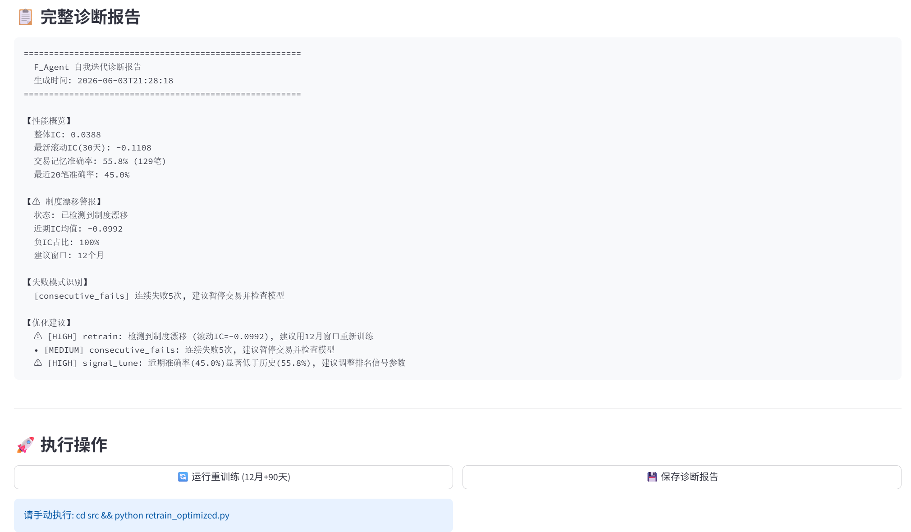 |
| **⚙️ 超参优化** | Optuna贝叶斯超参搜索 + 多模型集成 + 多时域预测 | 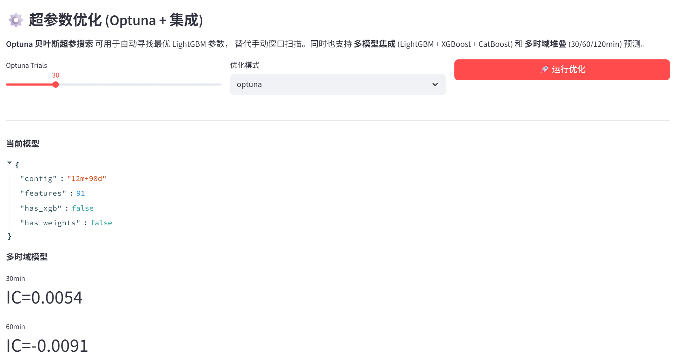 |
| **⏰ 定时调度** | 8个自动化任务 + 一键运行/暂停 + 守护进程 | 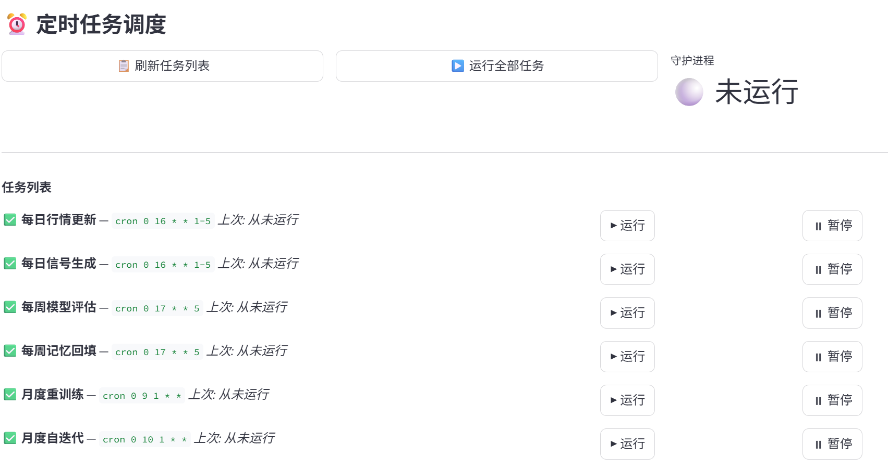 |
| **🔧 模型迭代** | 受控发布状态 + CNN研究特征 + 旧适配器退役状态 | 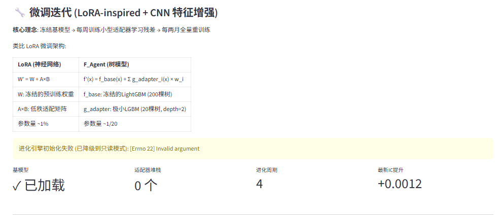 |

---

## 项目结构

```
F_Agent/
├── data/                              # 原始数据
│   ├── TL分钟级量价数据.pkl             # 分钟行情 (2023-04 ~ 2026-06, 488K行)
│   ├── TL合约价差日频数据.pkl           # 基差数据 (CTD券)
│   ├── main_contract_spliced.pkl       # 主力合约拼接中间文件
│   ├── tick/                           # 每日tick快照 (.pkl, 截止2025-10-31)
│   ├── macro/                          # AKShare 宏观数据缓存
│   └── rag/                            # RAG 索引 (ChromaDB + 研报PDF)
│
├── models/                             # 训练好的模型
│   ├── trained_model.pkl               # LightGBM 双模型 + scaler + 特征列表
│   ├── multi_horizon_model.pkl         # 多时域预测模型
│   ├── micro_cnn.pt                    # CNN时序卷积模型 (PyTorch)
│   └── adapter_stack.pkl               # 遗留实验文件（不读取、不写入）
│
├── outputs/                            # 输出文件
│   ├── df_factors.pkl                  # 因子集 (159K行 × 151特征)
│   ├── df_predictions.pkl              # 模型预测结果 (含Base_Pred/Adapter_Correction)
│   ├── tick_minute_features.pkl        # tick → 分钟微观特征
│   ├── macro_factors.pkl               # 宏观因子缓存
│   ├── signal.json                     # 最新交易信号
│   ├── feature_importance.csv          # 特征重要性
│   ├── trade_memory.jsonl              # 交易记忆 (每日信号+结果评估)
│   ├── params.json                     # 信号参数配置
│   ├── cron_jobs.json                  # 定时任务配置
│   ├── evolution_report.json           # 最新进化报告
│   ├── evolution_history.jsonl         # 进化历史记录
│   └── eval/iteration_report_*.json    # 评估/迭代诊断报告
│
├── src/                                # 源代码 (24个模块)
│   ├── main.py                         # ★ 入口: --mode train|inference|iterate|evolve
│   ├── dashboard_v2.py                 # ★ 研究工作台 (分层导航, 端口8503)
│   ├── signal_dashboard.py             # ★ 信号引擎 (甜点区排名信号)
│   ├── LightGBM_model.py              # ★ LightGBM 双模型训练 (自动识别CNN特征)
│   ├── self_evolution.py              # 旧适配器只读兼容状态（训练入口已停用）
│   ├── micro_cnn.py                   # ★ 微观CNN (Bottleneck Embedding Extractor)
│   ├── enhanced_factors.py            # ★ 制度自适应因子 (34个新增)
│   ├── self_iteration.py              # ★ 自我迭代引擎 (漂移检测+时间衰减)
│   ├── eval_runner.py                 # ★ 模型评估套件 (滚动IC+退化检测)
│   ├── factor_evaluator.py            # ★ Alphalens风格因子评估
│   ├── optuna_optimizer.py            # ★ Optuna超参优化+集成+多时域
│   ├── cron_scheduler.py              # ★ 定时任务调度 (8个任务+daemon)
│   ├── factor_extraction.py           # 因子构建主流程
│   ├── inference.py                   # 实时信号生成器
│   ├── backtest.py                    # 分状态策略回测
│   ├── backtest_v2.py                 # 排名信号回测+参数扫描
│   ├── macro_factors.py               # 宏观/资金面因子计算
│   ├── data_fetcher.py                # AKShare 宏观数据采集
│   ├── tick_data_processor.py         # tick → 分钟微观结构
│   ├── mc_ex.py                       # 主力合约拼接+复权
│   ├── update_market_data.py          # 行情数据增量更新
│   ├── strategy_agent.py              # CLI Agent 交互层
│   ├── llm_intelligence.py            # DeepSeek AI 情报分析
│   ├── rag_tool.py                    # RAG 研究工具 (爬虫+ChromaDB+LLM)
│   └── memory.py                      # 交易记忆系统
│
├── agentic_rag/                        # RAG 本地知识库文档
├── tools/                              # 辅助脚本
├── docs/                               # Dashboard 面板截图 (17张)
├── .env.example                        # API Key 配置模板
├── launch_dashboard.bat                # 一键启动 Dashboard (端口8503)
├── requirements.txt                    # Python 依赖
└── README.md                           # 本文件
```

---

## 快速开始

### A 股实时行情原型（只读）

项目已增加统一行情网关，默认通过腾讯网页报价查询最新价、源时间和五档盘口，并可显式切换到现有 AKShare 数据源：

```bash
PYTHONPATH=src .venv/bin/python src/realtime_quotes.py quote 600000 000001.SZ
PYTHONPATH=src .venv/bin/python src/realtime_quotes.py watch 600000 --interval 3 --count 5
PYTHONPATH=src .venv/bin/python src/realtime_quotes.py quote 600000 --provider akshare
```

网页行情没有延迟 SLA，输出会强制标记 `trade_eligible=false`，仅用于原型与监控。Ashare 的实时语义、数据源比较、生产架构和 QMT/RQData 升级路径见 [A 股实时交易系统方案](docs/ashare_realtime_system.md)。

```bash
# 1. 安装依赖
pip install -r requirements.txt
pip install torch --index-url https://download.pytorch.org/whl/cpu  # CNN模块需要

# 2. 设置 API Key (AI情报 & RAG)
# 方法一：在项目根目录创建 .env 文件（推荐，自动加载）
echo DEEPSEEK_API_KEY=***  F_Agent/.env

# 可选：启用固定版本 Jev 宏观语义因子
# TYPESAFE_API_KEY=***
# F_AGENT_JEV_MODE=online
# F_AGENT_JEV_MODEL=jev-1.13.0
# F_AGENT_JEV_GATE_MODE=shadow

# 方法二：Dashboard 系统设置（仅当前会话）
# 左侧「系统设置」→「连接与缓存」→ 本会话 DeepSeek API Key

# 方法三：系统环境变量
set DEEPSEEK_API_KEY=***

# 3. 每日更新行情
cd src && python update_market_data.py

# 4. (可选) 训练CNN微观特征嵌入
python micro_cnn.py pipeline        # 训练CNN → 提取64维嵌入 → 注入因子文件

# 5. 训练LightGBM (自动识别CNN特征)
python main.py --mode train

# 6. 启动 Dashboard
双击 launch_dashboard.bat → http://localhost:8503

# 7. 模型迭代
# 旧版 AdapterStack 已停用；所有候选统一经过成本后回测和 release gate
python main.py --mode train
python main.py --mode iterate       # 只读漂移诊断
```

Jev 默认完全关闭。`online` 用于首次生成内容寻址缓存，回测时建议切换为
`cache`；影子门控只记录 `maintain/reduce/abstain`，不会改变方向和仓位。
完整数据合同、质量门槛与回退方式见 [Jev 集成说明](docs/jev_integration.md)。

---

## CLI 操作速查

```bash
# === 核心流程 ===
python main.py --mode train          # 因子构建 + CNN注入 + 训练 + 回测
python main.py --mode inference      # 因子更新 + 实时信号
python main.py --mode iterate        # 自我迭代诊断
python main.py --mode evolve         # 微调迭代状态

# === CNN 微观嵌入 ===
python micro_cnn.py pipeline         # 一键训练CNN+提取+注入 (5-15分钟)
python micro_cnn.py status           # 查看CNN模块状态
python micro_cnn.py train --epochs 100  # 单独训练 (自定义轮数)

# === 模型迭代 ===
python main.py --mode train          # 候选训练 + 统一评估 + 受控发布
python main.py --mode iterate        # 只读诊断，不修改生产模型
python self_evolution.py status      # 查看旧适配器退役状态

# === 评估 & 优化 ===
python eval_runner.py --window 30    # 30天滚动评估
python factor_evaluator.py           # Alphalens风格因子评估
python optuna_optimizer.py --mode all --trials 50  # 超参搜索

# === 定时任务 ===
python cron_scheduler.py list        # 查看所有定时任务
python cron_scheduler.py run monthly_retrain  # 手动触发受控月度训练
python cron_scheduler.py daemon      # 启动后台守护进程

# === 数据维护 ===
python update_market_data.py         # 增量更新行情
python memory.py                     # 回填交易记忆
```

---

## 模型表现

| 指标 | 原始模型 (V0) | 优化后 (V2) | +CNN嵌入 |
|:--|:-----------:|:---------:|:------:|
| 训练窗口 | 9月+60天 | 12月+90天 | 12月+90天 |
| 特征数 | 56 | 91 | 155 (91+64CNN) |
| Test IC | 0.0150 | **0.0388** | 待评估 |
| Normal IC | -0.200 | **0.0536** | 待评估 |
| 信号方式 | 绝对阈值 | 甜点区排名 | 甜点区排名 |
| 数据覆盖 | 2023-04 ~ 2025-10 | 2023-04 ~ 2026-06 | 2023-04 ~ 2026-06 |

### Top 10 特征重要性

测量于 2026-06-04 的模型。排名第 1 的因子已在 commit f44e254 (2026-09-18) 删除，
当前管道改用 `Macro_State_Composite`（两者不等价），重训后该排名需重新测量。
各因子的计算公式与替代关系见 `src/factor_formulas.py`，也可在 Dashboard「因子实验室 → 因子分析」点击柱子查看。

| 排名 | 特征 | 重要性 | 类型 |
|:--|:--|:--|:--|
| 1 | ~~Macro_Surprise_Composite~~ | 81.0 | 宏观 (已删除) |
| 2 | CN_US_10Y_Spread | 51.0 | 宏观 |
| 3 | Basis_ZScore_20 | 39.0 | 基差 |
| 4 | Short_Momentum_5D | 38.0 | 动量 |
| 5 | CN_US_10Y_Spread_Z | 33.0 | 宏观 |
| 6 | Mid_Momentum_2M | 31.0 | 动量 |
| 7 | Mid_Momentum_1M | 30.0 | 动量 |
| 8 | YC_Slope_30Y_10Y | 29.0 | 宏观 |
| 9 | YC_Curvature | 29.0 | 宏观 |
| 10 | Basis_ZScore_10 | 26.0 | 基差 |

---

## 因子体系 (151维 + 64维CNN嵌入)

| 类别 | 数量 | 代表因子 |
|:--|:--|:--|
| 动量 | 7 | Short_Momentum_1D/3D/5D, TSMOM, Mid_Momentum_1M/2M |
| 波动率 | 6 | RV_30, RV_120, Vol_Surge, ATR_14, Vol_Regime |
| 微观结构 | 44 | Spread, Imbalance, Signed_Vol, VPIN, HF_RV, Cum_Net_Open |
| 量价 | 4 | OI_Volume_Flow, Smart_Money, Large_Trade_Direction |
| 技术 | 4 | MACD_Hist, RSI, BB_Position |
| 市场状态 | 4 | Market_Regime, Is_High_Vol, Trend_Consistency |
| 基差 | 3 | Basis_ZScore_20, Basis_ZScore_10, Basis_Trend |
| 宏观 | 14 | CN_US_10Y_Spread, PMI_State_ZScore, M2_State_ZScore, YC_* |
| 增强因子 | 35 | OI_Growth_5D/20D, Vol_Breakout, ADX, Spread_Stress, Vol_of_Vol |
| **CNN嵌入** | **64** | **CNN_Emb_00 ~ CNN_Emb_63 (时序CNN瓶颈输出)** |

---

## 信号参数

当前使用**甜点区排名信号**（基于219笔交易记忆回测优化）：

| 参数 | 值 | 说明 |
|:--|:--|:--|
| 平滑窗口 | 60 | EMA平滑跨度 |
| 回看区间 | 480 bar | 排名计算窗口 |
| 信号确认 | 10 bar | 连续同向才确认 |
| 做空甜点区 | rank 15%-30% | 准确率 72.7% |
| 做多甜点区 | rank 70%-85% | 准确率 63.6% |
| 跳过区间 | 0-15%, 85-100% | 极端排名=噪声 |

---

## 自动化调度 (8个任务)

| 任务ID | 频率 | 功能 |
|:--|:--|:--|
| daily_update | 工作日 16:00 | AKShare拉取最新分钟行情 |
| daily_signal | 工作日 16:00 | 基于最新数据生成交易信号 |
| weekly_eval | 周五 17:00 | 滚动窗口IC评估+退化检测 |
| weekly_memory | 周五 17:00 | 同步交易记忆与实际结果 |
| weekly_adapt | 周六 08:00 | 已停用的遗留任务（调度器强制拒绝） |
| monthly_retrain | 每月1号 09:00 | 候选训练+统一回测门禁+受控发布 |
| monthly_iteration | 每月1号 10:00 | 自我迭代诊断+制度漂移检测 |
| bimonthly_retrain | 双月1号 09:00 | 已停用的遗留任务（调度器强制拒绝） |

```bash
python cron_scheduler.py daemon    # 后台守护进程
python cron_scheduler.py run monthly_retrain  # 手动运行受控训练
```

---

## 关键发现与经验教训

### 1. 极度正则化是金融ML唯一有效策略（缺少高精度数据情况）
金融时间序列信噪比极低 (最优单特征IC仅 0.02-0.03):
- LightGBM: `max_depth=3, lambda_l1/l2=15, feature_fraction=0.3, min_child=350` — 必须
- MSE loss 追逐离群值, MAE 预测条件中位数更稳健

### 2. 模型自信 ≠ 准确
甜点区发现: 模型在极端排名时(rank<15%或>85%)反而错误率最高
- 极端做空 (0-15%): 55.6% | 做空甜点 (15-30%): **72.7%**
- 极端做多 (85-100%): 46.9% | 做多甜点 (70-85%): **63.6%**

### 3. 特征筛选破坏树模型
将91特征降到40个(按|IC|排序): IC从 0.039 跌到 0.000 — LightGBM依赖弱特征间的交互

### 4. CNN时序嵌入的合理性
受限于L1盘口数据，用**时间维度补偿空间维度不足**：学习微观特征在30bar内的动态演化模式优于静态快照

### 5. 旧 LoRA 类比不足以构成发布证据
早停或低容量不能证明样本外有效性。旧 AdapterStack 缺少统一成本后回测、
attestation 和不可放松的门禁，因此已停用；只有通过当前 release gate 的候选
才可进入生产推理。

---

## 已知限制

- **Tick数据截止**: 2025-10-31，之后微观结构因子填0 → CNN仅在tick覆盖期训练
- **SHIBOR/Repo**: AKShare接口偶有编码/SSL问题，资金面因子可能缺失
- **当前发布状态**: 若不存在 `artifacts/models/current.json`，生产推理会按设计失败关闭，需显式训练并通过门禁后才可启用

---

## 免责声明

本项目仅供学习和研究使用，不构成任何投资建议。量化策略基于历史数据回测，过往表现不代表未来收益。
