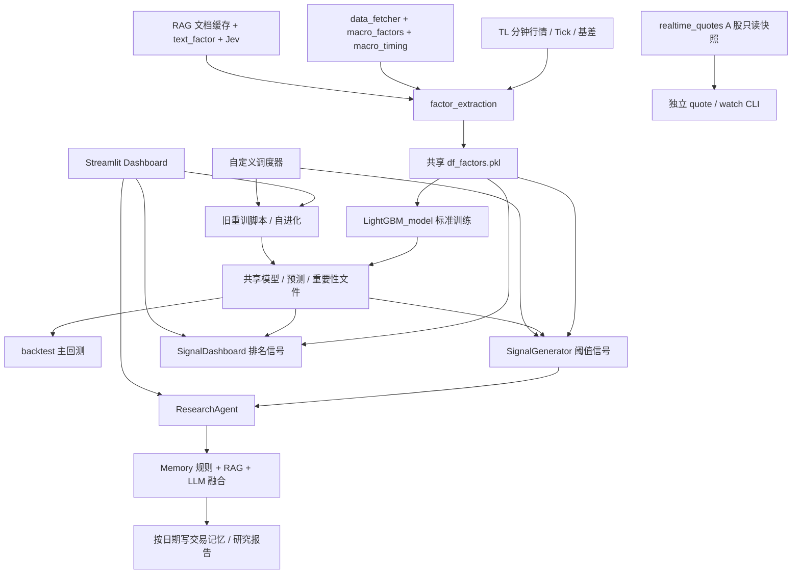
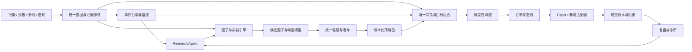
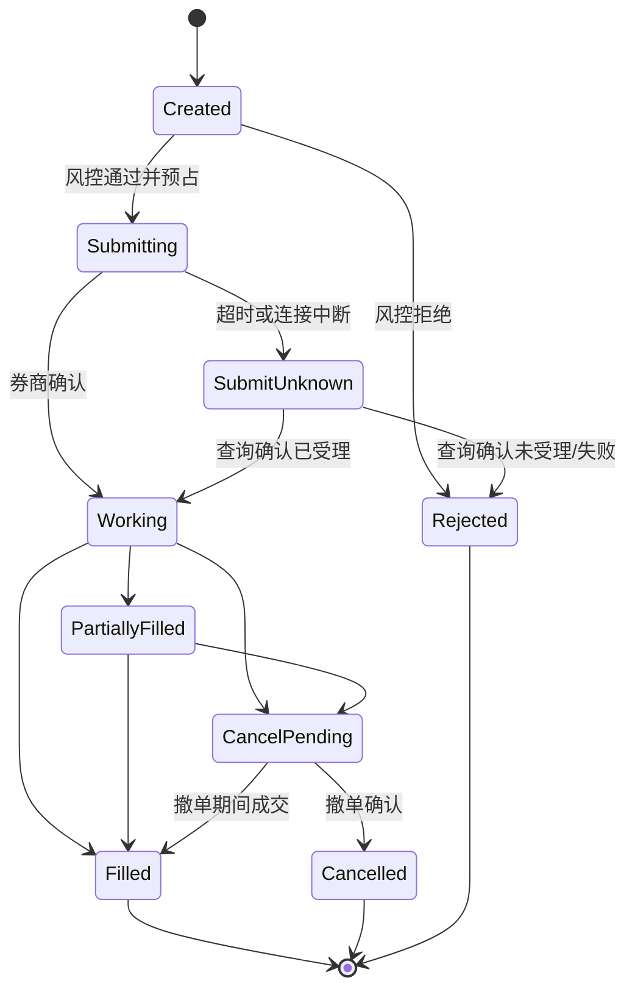

# F_Agent 架构调研与金融 Research Agent 收敛方案

调研日期：2026-09-22—2026-09-23（北京时间）

代码基线：`main`，`8026714`（`feat(market): add guarded A-share quote gateway`）

文档状态：调研基线 + P0/P1 实施记录；交易执行域仍未实施。

目标：整合现有能力，形成可持续监控舆情、提出并验证因子、结合宏微观信息、管理组合并执行交易的金融 Research Agent。

> 2026-09-23 实施更新：本文第 2—4 节保留的是 `8026714` 基线问题快照，
> 便于理解改造原因；其中“当前”描述不再全部代表改造后的工作树状态。
> 已完成项和仍未完成边界以第 0 节及
> [TL Agent 运行与发布手册](./tl_agent_operations.md)为准。

## 0. P0/P1 实施结果（2026-09-23）

本轮已在不训练新模型、不连接券商、不发单的前提下完成以下收敛：

| 领域 | 已实现 | 明确未实现 |
|---|---|---|
| 策略决策 | `StrategySpec`、稳定 fingerprint、`SignalPolicy`、`SignalDecision`；CLI、Dashboard、回测、记忆与 ResearchAgent 共用默认 `tl_regime_breakout_v1` | 多资产组合构建、A 股策略迁移、真实成交模型 |
| 时序与回测 | `execution_lag_bars` 明示生效滞后；未知未来可交易时刻不伪造 `effective_from`；`Held_Position` 只获得持有期间收益；成本参数来自策略契约 | paper/live 撮合、涨跌停与停牌等 A 股微观约束 |
| 模型运行与发布 | `ModelRuntime` 只读推理；候选根目录约束、哈希 manifest、不可由调用方绕过的 gate attestation、正收益/Sharpe 成本回测门禁、release lock、唯一原子 `current.json`、历史 release 回滚；旧 `AdapterStack` 全入口停用且不再反序列化遗留 pickle | 本轮未实际训练或提升任何模型；当前未托管旧 pickle 被生产推理拒绝，现有模型收益未重新确认 |
| 舆情监控 | SQLite 原文/复合游标事务、跨源事件聚类、结构化评估、提示注入隔离、告警生命周期、传输/内容新鲜度、配额、一次运行与 watch/backoff | 首个默认源仍是东方财富全球 7×24/AkShare 原型；未验证新闻覆盖、授权、实时 SLA |
| Agent 边界 | ResearchAgent 先监控再生成唯一基础 Decision；RAG/Jev/LLM 只生成影子研究建议；不存在启用交易调整的开关 | broker、订单、成交、账户、风控预占、对账全部未实现 |
| 运行入口 | `main.py --mode monitor/research/inference/train/rollback`；Dashboard 展示源健康、事件、告警及影子建议；cron 五字段匹配、错误传播、daemon 心跳与旧任务迁移 | 任务队列、分布式 worker、市场日历 |

验证结果：离线全量测试 `201 passed, 2 warnings in 1.62s`；四个关键新增模块合计 branch coverage 为 `82%`。该结果验证软件契约和安全边界，不代表数据源在线可用、模型有效、策略盈利或系统可实盘。本轮没有创建活动 `current.json`，因此在显式训练并成功发布前，生产推理会按设计失败关闭。

## 1. 核心判断

项目值得继续演进，最应保留的是已经改进的时点数据处理、因子计算、LightGBM 训练验证、语义因子校验和行情适配接口。当前主要问题是**同一职责存在多套实现，但关键闭环缺少统一负责人**。

具体表现为：研究入口、看板、回测和交易记忆使用不同信号规则；多条训练路径可以写同名模型；新闻与 RAG 缺少一致的更新和历史时点约束；研究日志承担了部分“交易记忆”的角色，却没有真实订单、成交和账户账本。

建议目标是：**一个模块化 Python 应用、一条可追踪的研究流程、一套策略决策规则、一个独立的交易执行边界、四个面向工作任务的页面。** 优先统一职责和数据契约，保留 Streamlit，暂不同时迁移前端、引入微服务和整包接入多个 Agent 框架。

按此前讨论，本文暂以 **A 股为下一阶段落地方向，TL 为保留的研究策略配置**。默认建议普通现金账户、多头策略、日级或多日持有、分钟级择时。此项是设计假设，不代表账户、券商或策略周期已经确定。

本轮结论分三类：

- **代码事实**：能定位到当前源码或本轮验证结果。
- **外部事实**：来自本轮阅读的官方文档、项目仓库或原始论文。
- **建议**：针对本项目的架构选择和验收标准，不代表已经实现或证明有收益。

## 2. 调研范围与验证边界

### 2.1 仓库快照

| 项目 | 本轮检查结果 |
|---|---|
| `src/` 顶层 Python 文件 | 45 个，合计 19,845 行，包含注释和空行 |
| 最大文件 | `dashboard_v2.py` 1,858 行；`dashboard.py` 1,398 行；`self_evolution.py` 1,335 行；`rag_tool.py` 1,227 行 |
| 两个 Dashboard 文件 | 共 3,256 行，约占上述源码行数的 16.4% |
| 当前主界面 | 12 个顶层 Tab，另有嵌套 Tab；README 中“14 个面板”不是当前接线 |
| 测试 | 17 个 `test_*.py` 文件；本轮运行结果为 **96 passed in 1.30s** |
| A 股现状 | 独立只读行情模块，没有接入现有 TL 研究主链；未发现券商下单、成交回报和对账实现 |
| 本轮写入范围 | 仅新增本文档；不运行训练、不更新数据源、不变更模型和参数、不连接交易账户 |

测试命令：

```bash
PYTHONDONTWRITEBYTECODE=1 .venv/bin/python -m pytest -q -p no:cacheprovider
```

检查采用文件清单、Python AST 导入关系、核心调用链阅读、官方资料交叉验证。另执行了两个不访问外部服务、不写业务数据的函数级诊断：调度时间匹配和融合文本解析，结果见第 4 节。

**96 项测试通过不等于交易系统通过验收。** 现有测试主要覆盖宏观时点、缓存、标签、因子评估、Jev 和只读行情。完整研究流程恢复、跨入口信号一致性、订单生命周期、组合约束和账户对账尚无对应的完整验证链路。本轮没有重跑真实数据训练或成本后回测，也没有确认本地模型当前的收益或有效性。

开始调研时工作区已有 `outputs/params.json`、`outputs/trade_memory.jsonl` 的修改，以及未跟踪的研究材料和模型目录；它们均不属于本轮改动。

### 2.2 需要纠正的文档认知

README、CLAUDE.md 和旧设计文档记录了不同阶段的状态，不能合并理解为当前全部启用：

- “LightGBM 双模型”是历史架构；当前标准训练入口比较 `flat_combined` 与 `hierarchical`，产物中的 `model_active` 为 `None`。
- `main --mode moe` 目前转发到新训练入口，不再运行旧 MoE 训练流程。
- `main --mode evolve` 主要展示状态和子命令；`iterate` 主要产生诊断和建议。
- 当前 UI 是 12 个顶层 Tab，但旧渲染函数和旧 Dashboard 仍在仓库中。
- “LoRA 式适配器”是树模型残差叠加的类比，不是对 LLM 做 LoRA 微调。
- 旧文档中的 IC、准确率、数据覆盖日期不能当作当前模型的已验证成绩。

依据：[主入口][L01]、[当前训练产物][L02]、[MoE 转发入口][L03]、[当前 UI 接线][L04]。

## 3. 当前架构实际如何运转

### 3.1 主调用链



这是一套以共享本地文件连接的研究应用。`df_factors.pkl`、`trained_model.pkl`、`df_predictions.pkl`、`signal.json` 等文件同时承担数据交换、最新状态和部分版本管理职责。它们没有共同的 `run_id` / `release_id` 来保证所有消费者读取同一组产物。

`ResearchAgent.run_cycle()` 的真实闭环是“构建因子 → 生成信号 → 融合 → 记录信号 → 用预测文件回填标签结果 → 保存报告”，不包含研究问题管理、自动实验计划、券商下单和真实成交反馈。[研究编排源码][L05]

### 3.2 能力地图

| 领域 | 现有模块 | 已有价值 | 当前边界 |
|---|---|---|---|
| 数据采集 | `data_fetcher`、`update_market_data`、`realtime_quotes` | 宏观数据缓存、TL 行情更新、A 股快照协议 | 不同数据面尚未共享一致的快照、日历和质量状态 |
| 宏观与文本时点 | `macro_timing`、`macro_factors`、`text_factor` | `available_ts`、原生频率、TTL、语义事件 | 缺少统一的修订版本管理；历史 RAG 查询未统一接入时点约束 |
| 因子与验证 | `factor_extraction`、`enhanced_factors`、`feature_registry`、`training_data`、`factor_evaluator` | 特征分组、按合约标签、purge、因子评估 | 主链仍围绕 TL 单品种时序构建，尚非 A 股截面因子平台 |
| 候选挖掘 | `genetic_factor_miner`、`micro_cnn`、`optuna_optimizer` | 公式发现、学习型嵌入、参数搜索 | 候选入口与训练/发布路径不统一，部分仍直接改变共享文件 |
| 模型 | `LightGBM_model`、`hierarchical_model`、`moe_model`、旧重训脚本 | 已有平铺/宏微观分层消融和基础发布门槛 | 新旧产物契约、选择口径和写入路径并存 |
| 情报与知识 | `llm_intelligence`、`rag_tool`、`jev_client`、`jev_evaluation` | 新闻分析、文档检索、结构化语义概率、语义门槛 | 不是完整的增量舆情监控，缺少统一事件中心 |
| 决策与界面 | `inference`、`signal_dashboard`、`signal_fusion`、两个 Dashboard | 预测、信号、解释、操作界面 | 同一业务规则在多处重写，UI 承担业务编排 |
| 反馈与运行 | `memory`、`self_iteration`、`self_evolution`、`eval_runner`、`cron_scheduler` | 信号复盘、漂移报告、适配实验、定时触发 | 研究记忆与交易账本混淆，调度和恢复能力不足 |
| 交易执行 | 尚无统一模块 | 可沿用现有行情协议作为输入边界 | 账户、订单、成交、风险预占、撤单、对账均待建设 |

## 4. 臃肿和重复的根因

### 4.1 同一个“策略”有多种定义

| 路径 | 当前信号口径 | 后果 |
|---|---|---|
| `inference.SignalGenerator` | EMA 160；expanding quantile；生成最新方向时读取正常状态阈值 | CLI 与 ResearchAgent 采用此口径 |
| `backtest.Backtester` | EMA 160；滚动阈值；分状态确认、持有期和冷却期 | 主回测并非对 CLI 决策过程的直接重放 |
| `signal_dashboard.SignalDashboard` | EMA 60；480 根窗口；15%–30% / 70%–85% 排名区间；连续确认 | 看板展示的是另一套策略 |
| `memory.backfill_from_predictions` | 再次独立实现排名、确认和按日抽样 | 改一个入口不会自动同步记忆统计 |

依据：[推理信号][L06]、[主回测规则][L07]、[看板信号][L08]、[记忆回填][L09]。

还有一个界面内分叉：侧边栏使用 `SignalDashboard` 动态计算信号，而“运行融合决策”按钮把 `ctx.signal`，即文件中的 `signal.json`，交给融合器。因此，同一页面看到的方向与被融合的方向可能来自不同时间、不同规则。[UI 融合输入][L10]

**建议**：建立唯一的 `SignalPolicy` 和版本化 `StrategySpec`。CLI、回测、看板、paper 和 live 都消费同一个 `Decision`；看板只展示，不重新推导信号。历史策略可以保留为不同配置，不能共享名称和成绩。

### 4.2 生产模型有五个写者，发布并不统一

当前能写入 `models/trained_model.pkl` 的源码路径有：

1. `LightGBM_model.py`：标准候选训练与 gate。
2. `retrain_optimized.py`：旧窗口扫描和保存。
3. `retrain_v2.py`：旧配置扫描和保存。
4. `train_final.py`：模块顶层执行训练与保存。
5. `self_evolution.py`：直接重训 fallback。

后四条没有统一经过标准入口的标签、切分和发布逻辑；旧窗口扫描仍按 `test_ic` 排名。调度器还保留默认启用的 `retrain_optimized.py` 路径。部分脚本在当前 macOS 上会先遇到 Windows 路径问题，不能因此将它们视为已经退役。[写入位置][L11]、[L12]、[L13]、[L14]、[调度入口][L15]

标准入口已经有值得保留的改进，但还有三点限制：

- 当前 gate 主要检查 IC 和验证期稳定性；`main.run_train()` 在模型提升之后才执行策略回测，成本后亏损或执行约束不满足不能在该位置阻止发布。
- 模型、预测、重要性分别 `os.replace`，每次替换是单文件操作，不是完整版本包的事务切换。
- `iter_purged_walk_forward()` 已存在，但当前标准训练入口没有调用它；把一次验证期切成五块做稳定性评估，不等于五次重新训练的 walk-forward。

依据：[训练调用顺序][L01]、[发布逻辑][L02]、[训练切分工具][L16]。

**建议**：所有训练和适配只写候选目录，由唯一 `ReleaseManager` 在完整评估后更新一个版本指针。封存集使用记录也要持久化，不能每次调整后重复观察同一“封存集”却仍称其独立。

### 4.3 回测、推理与实际执行缺少共同时间合同

主回测计算当前行仓位后，以 `Position_t × (close_t / close_{t-1} - 1)` 计算收益；V2 回测则使用滞后仓位。与此同时，标准标签默认 `entry_lag_bars=1`。[主回测收益][L17]、[V2 回测][L18]、[标签合同][L16]

这至少说明决策时点、成交时点和收益归属没有统一。对于“收盘后生成信号、下一可成交时点入场”的目标语义，当前主回测的同 bar 收益归属需要修正。不能仅凭已有曲线判断哪条路径可实盘。

**建议**：先规定 `bar_start/end → decision_ts → earliest_execution_ts → fill_ts`，再让回测和 paper 使用同一订单意图与执行约束；采用什么成交价和滑点模型必须写入实验配置。

### 4.4 舆情采集、RAG 和语义打分尚未形成统一事件链

目前存在三种不同缓存策略：宏观缓存带区间和 schema 检查；新闻缓存只要文件存在就返回；部分 RAG 采集缓存也只检查文件是否存在。后两者没有统一 TTL、增量游标和源健康状态。[宏观缓存][L19]、[新闻缓存][L20]、[RAG 缓存][L21]

此外：

- 新闻入口只配置了一个东方财富来源，并按债券关键词过滤，不能代表全市场或公司级舆情监控。
- `RAGAnalyzer.query()` 没有强制 `as_of` 参数；融合调用也没有传历史时间过滤。“近期”只写在自然语言问题里，不构成时间约束。
- RAG 的部分政策报告和本地材料只有 `period` / `fetched_at`，没有真实发布时间。新语义事件导出拒绝它们是正确行为，但其知识检索能力与可回测事件覆盖率是两回事。
- 当前本地材料加载支持 PDF、TXT、Markdown，不支持目录中的 DOCX/PPTX 直接解析。
- `build_index(force_refresh=True)` 会重建向量集合，但不意味着所有底层来源缓存都已刷新。

依据：[RAG 查询][L22]、[语义事件导出][L23]、[本地文档加载][L24]。

**建议**：所有新闻、公告、政策文档先进入统一的文档/事件存储；知识检索、实时监控和文本因子从同一来源读取，各自使用适合的时间与保留策略。保留 RAG 和结构化语义分析，两者职责不同；取消对同一材料的多次独立方向判定。

### 4.5 Jev 的影子边界没有覆盖旧 LLM 融合逻辑

Jev 只支持 `off/shadow`，影子结果不修改方向和仓位；这是明确且可复用的边界。但旧 DeepSeek 融合分支仍通过自由文本关键词修改方向和仓位。[融合流程][L25]

本轮只调用解析函数，输入原始方向 `+1` 和以下文本：

```text
不建议反转做空，明确保持做多。
```

实际得到 `adjusted_direction=-1`。原因是代码只检查“反转/做空/反向”和“强烈/明确/建议反”的出现，没有处理否定和结构化含义。[解析函数][L26]

当前没有券商通道，因此这不是已发生的真实误下单；但它说明不能把现有融合输出直接连接未来执行器。

**建议**：统一 `EventAssessment` / `ResearchAssessment` schema，包含标签、证据、概率和缺失原因；LLM/Jev 只输出研究判断，确定性的策略与风险模块计算目标仓位。模型概率需要校准，不直接解释为胜率或仓位百分比。

### 4.6 “交易记忆”实际是信号日记，无法充当成交账本

`record_signal()` 按 `trade_dt` 替换同一天记录，没有证券、策略、决策 ID 的组合主键。`backfill_from_predictions()` 会重写全部记录；`update_actuals()` 用某日最后一条预测的 `Target_Ret` 回填，并非用真实成交计算损益。[记忆实现][L09]、[结果回填][L27]

研究报告同一天写同一个文件；融合历史只保留最近 100 条。它们适合原型展示，但无法完整重放多标的盘中决策。[研究报告][L05]、[融合历史][L28]

**建议**：分别保存知识证据、实验结果、决策记录、订单/成交账本；界面可整合为一个复盘入口，但数据语义不能混用。新反馈必须带 `decision_id → order_intent_id → broker_order_id → fill_id`，区分模拟结果和真实结果。

### 4.7 调度器存在可复现的日期匹配问题

`_cron_hour_match()` 解析了分钟和小时，只有星期字段包含 `-` 时才检查星期；未处理月、日期或单个星期值。[调度实现][L29]

本轮函数级诊断结果：

| 表达式 | 检查时刻 | 预期 | 实际 |
|---|---|---|---|
| `0 8 * * 6`，每周六 | 2026-09-22 周二 08:00 | 不匹配 | 匹配 |
| `0 9 1 * *`，每月 1 日 | 2026-09-22 09:00 | 不匹配 | 匹配 |
| `0 9 1 */2 *`，隔月 1 日 | 2026-09-22 09:00 | 不匹配 | 匹配 |

这证明解析存在问题，不代表后台任务当时正在运行。当前守护循环还是顺序阻塞执行；耗时任务可能影响后续分钟匹配。仅检查子进程退出码，也不能识别所有“打印错误后正常返回”的业务失败。

**建议**：调度只负责提交任务，采用成熟日期触发实现和市场日历；执行流程持久化任务状态、幂等键、依赖、重试和超时。月度重训与双月重训合并为一套重训策略，不能同时作为生产模型写者。

### 4.8 UI 合并了入口，底层职责仍未收敛

`dashboard_v2` 已经把部分入口合并，但仍直接导入旧 `dashboard` 的市场、因子、回测和宏观渲染函数；文件中也保留了当前 `main()` 未接线的 RAG、调参和旧进化页面。训练通过 UI 内 `subprocess.run` 同步执行。[UI 接线][L04]、[旧页面复用][L30]

旧 Dashboard 和调度器仍有 Windows `BASE_DIR`，而新入口使用 `config.BASE_DIR`。`st.cache_resource` 缓存的模型对象没有以 `release_id` 为键，单纯替换模型文件也不等于所有界面立即加载新模型。

**建议**：收敛业务服务后再删除旧页面；训练提交到 worker，UI 只显示任务进度和结果。按引用关系判断能否删除，不能直接删除仍被新界面调用的旧文件。

### 4.9 “自我进化”混合了监控、实验和产物修改

`self_iteration` 主要输出诊断和参数建议；`self_evolution` 另有训练和保存流程。其 `FrozenBaseModel` 不读取当前产物的 `selected_model_kind/hierarchical_model`，每周适配器的入栈也没有统一使用标准 release gate。普通 `SignalGenerator` 没有加载该适配器堆栈。[诊断建议][L31]、[适配基模型][L32]、[适配器入栈][L33]

因此，“已经训练适配器”“组合预测文件已保存”“实时推理正在使用适配器”是三个不同状态。

**建议**：监控生成 `AdaptationProposal`，实验引擎验证候选，发布服务决定是否提升；所有预测统一通过 `ModelRuntime`。CNN、残差适配器、MoE、Optuna 保留为可选研究实验，不作为默认自动循环叠加运行。

## 5. 哪些保留、合并、隔离和补齐

| 当前能力 | 处理建议 | 收敛后的负责人 |
|---|---|---|
| 宏观时点、TTL、标签 purge、特征 schema | 保留并扩展，不重写一遍 | `data` / `research` |
| 宏观、新闻、文档缓存代码 | 统一 provider 元数据和质量接口，允许不同刷新策略 | `data` |
| 新闻分析、RAG 回答、政策打分、Jev | 一次事件抽取供多个消费者使用；关键词作为显式 baseline/fallback | `intelligence` |
| CLI、UI、回测中的信号规则 | 合并实现；不同策略只保留为版本化配置 | `decision` |
| 因子分析、因子评估、遗传挖掘 | 合并到研究实验室，共享实验协议 | `research` |
| 模型评估、自我迭代、交易反思 | 统一复盘服务，分别计算研究、策略、成交层指标 | `application` / `research` |
| `retrain_*`、`train_final` | 先撤销生产写权限，再移入实验/归档入口 | `research` |
| CNN、旧 MoE、Optuna、LLM 直接预测、残差适配 | 可选实验，未通过同一 gate 不进入默认路径 | `experiments` |
| 两个 Dashboard | 先抽服务，再合并为一个 UI 入口 | `ui` |
| 调度与 research loop | 统一任务提交、状态与运行记录 | `application` |
| A 股行情适配 | 保留协议和质量字段，接入统一市场数据面 | `data` |
| 组合风控、订单、成交、对账 | 必须新增，现有回测和 memory 不能替代 | `execution` |

“合并”指一个业务概念只有一个权威实现，不是把所有函数搬进更大的文件。原始证据、向量检索和文本因子可以共享文档源，但不能强行使用同一种存储或同一个缓存失效时间。

## 6. 外部方案调研与选择

### 6.1 框架对照

以下“官方能力”来自来源；“本项目选择”是架构建议。没有把项目宣传或示例收益当作可迁移的实盘证据。

| 方案 | 官方能力 | 本项目选择 | 不直接整包接入的原因 |
|---|---|---|---|
| Microsoft Qlib | 配置化数据、模型、信号分析、回测与实验记录 [S01] | 借鉴实验契约；A 股截面研究可做单独后端适配试验 | 当前 TL 数据、宏观事件和信号规则需要适配；再并存一套训练/回测入口会增加口径冲突 |
| Microsoft RD-Agent | 因子假设、实现、Qlib 回测、结果反馈与再迭代 [S02] | 借鉴“假设—实验—反馈”协议；作为可选离线候选生成器 | 自动代码研发和研究依赖较多；不能让候选生成直接写生产模型 |
| LangGraph | checkpoint、跨运行状态保存、interrupt/resume [S03][S04] | 需要跨天恢复、分支研究或人工审阅时，作为唯一研究编排实现的候选 | 不提供金融数据、执行幂等或收益验证；恢复节点可能重跑副作用 |
| FinRobot | 股票分析、财务与估值研究、报告生成 [S05] | 借鉴研究报告结构和证据组织 | 报告生成能力不能代替本项目的账户与订单生命周期 |
| FinGPT | 金融情绪、实体/关系抽取等任务与模型资源 [S06] | 用于比较文本任务基线，按需换后端 | 暂无必要为项目新增一整套本地大模型训练与服务 |
| Jev / TypeSafe | Choice 返回结构化分类和概率 [S07] | 复用现有接入，纳入统一语义接口 | 语义分类概率不是收益概率；还需项目自己的中文评估与因子验证 |
| VeighNa / vn.py | 事件驱动、网关、paper、行情记录、风险管理等模块 [S08] | 若未来扩展多市场，考虑复用执行适配层 | 当前若只接一个 A 股券商，同时维护自研平台和整套 vn.py 会增加运维面 |
| QMT / XtQuant | 行情订阅，以及报单、撤单、资产/订单/成交/持仓查询和回调 [S09][S10] | A 股券商通道的优先验证对象 | 需要实际券商权限、客户端与运行环境验证；文档支持不等于用户账户已开通 |

### 6.2 推荐组合

近期选择：**现有 Python/LightGBM + Streamlit + 统一数据与实验契约 + 事务化运行/决策记录 + 独立 broker adapter**。

第一轮收敛先保留显式 Python 工作流，记录 `RunState`，不同时重写编排框架。如果下一阶段确实需要长任务暂停恢复和多分支交互，可采用 LangGraph 持久化实现替换该编排层；不再并行维护第二套研究状态机。周期触发与工作流执行是两个职责，也不能让多个 scheduler 争抢同一任务。

LangGraph 官方明确说明恢复时节点代码可能重跑，副作用需要幂等处理。因此，即使未来引入 LangGraph，订单提交也必须通过独立的幂等订单服务，不能由“图已保存 checkpoint”推导出“订单只会下达一次”。[S04]

不建议当前同时引入 Qlib、RD-Agent、FinRobot、FinGPT、LangGraph、vn.py 作为主运行依赖。先借鉴契约和边界，需要替换某一能力时再用 adapter 接入一个方案。

### 6.3 舆情与研究数据来源

| 信息类型 | 优先来源/候选 | 使用设计 |
|---|---|---|
| 政策和宏观事实 | 央行、统计部门、交易所原文；保留现有宏观采集 | 原始数值、发布时间和修订版本优先；研报解释不能替代官方事实 |
| 公司公告 | 原始公告或有授权的聚合源；Tushare `anns_d` 是候选 | 官方接口含公告 URL 和可选 `rec_time`；要显式请求并验证时间覆盖 [S11] |
| 财经快讯 | 有权限的 Tushare `news` 等文档化接口 | 提供时间范围查询和新闻时间，需单独权限；做增量游标，不据此承诺 tick 级到达 [S12] |
| 研报与本地研究 | 现有 `agentic_rag` + 可授权研报源 | 标记作者、机构、原始日期；无可靠发布时间的材料只用于知识问答 |
| 社区讨论 | 后续按授权条件和研究需求接入 | 与事实新闻分开，输出讨论热度和观点分歧；单条传闻不自动升级为事实 |
| 交易行情 | 当前网页源用于展示；验证 XtData 或其他有权限数据源 | 保留源时间、接收时间、质量状态和可交易性；不自动将网页备源提升为下单行情 |
| 公司基本面 | 有时点公告数据的财务 provider | 保存报告期、公布时刻、重述版本；当前项目需要新增此能力 |

本轮只验证了接口文档，没有购买权限、测试新闻覆盖或测量盘中到达延迟。连接器价格、可用权限和真实 SLA 需要在供应商与账户确定后验证。

## 7. 目标架构：模块化应用与明确执行边界

### 7.1 六个职责域

| 模块 | 拥有的数据/规则 | 对外产物 |
|---|---|---|
| `data` | provider、交易日历、证券主数据、文档/行情/宏观原始数据、质量状态 | `Document`、`MacroObservation`、`MarketSnapshot`、`DataSnapshot` |
| `intelligence` | 去重聚类、实体映射、语义抽取、证据检索 | `EventAssessment`、`EvidenceBundle` |
| `research` | 因子定义、候选挖掘、标签、切分、实验、评估、模型版本 | `FactorSpec`、`ExperimentReport`、`ModelRelease` |
| `decision` | 唯一信号策略、资产配置、目标组合 | `Decision`、`TargetPortfolio` |
| `execution` | 确定性风控、订单意图、提交、撤单、成交与对账 | `OrderState`、`Fill`、`AccountSnapshot` |
| `application` | 研究任务、调度、运行状态、反馈与报告组织 | `ResearchRun`、`AdaptationProposal`、用户任务视图 |

模块是代码与权限边界，不要求各自变成网络服务。原型可使用一个应用和后台 worker；券商需要不同操作系统或进程生命周期时，单独部署执行 adapter。



事件用于决策前，也必须经过时间、schema、语义版本和该策略的使用权限检查。箭头表示有类型的输入输出关系，不代表任何新事件都自动触发交易。

### 7.2 Research Agent 应负责什么

建议先做一个主研究编排器，以工具调用完成以下工作：

1. 把用户问题或事件转成可验证假设。
2. 检索时点内证据，注明支持、反对、缺失和来源。
3. 从白名单数据、算子和模型中提出实验配置。
4. 提交实验，读取状态与结果；根据预算决定是否继续。
5. 输出研究结论、候选因子或交易计划草案。
6. 根据真实反馈发起新的研究任务。

工具可为 `search_evidence(as_of)`、`get_market_snapshot()`、`propose_factor()`、`run_experiment()`、`compare_runs()`、`explain_decision()`、`draft_trade_plan()`。计算、回测和风控由确定性工具完成；行情刷新频率不等于 LLM 调用频率。

研究服务不持有券商提交凭据。交易计划的执行由已配置的策略版本、交易模式和风险限制决定。未来可支持人工确认模式或已授权策略范围内的自动执行模式，不要求每笔规则内订单都重新进行自然语言审批。

### 7.3 三条运行节奏

| 工作流 | 触发 | 时延侧重点 | 失败时行为 |
|---|---|---|---|
| 监控 | 新文档、行情异常、定时增量检查 | 秒到分钟，依源能力配置 | 报告 source stale；不把缺失伪装成“无事件” |
| 研究 | 用户任务、重要事件、漂移建议 | 分钟到小时，受实验预算约束 | 可恢复；失败候选保留原因，不改变已发布策略 |
| 交易 | 已发布策略的行情/时间触发 | 本地确定性路径 | 停止不满足条件的新委托，继续接收回报、查询和对账 |

交易循环不等待新闻摘要生成，不在每次推理时重建完整因子文件，也不在行情回调中运行训练。LLM 服务不可用时，能否继续量化策略由该策略声明的必需依赖决定。

## 8. 舆情、因子与宏微观怎样真正结合

### 8.1 舆情输出应是事件，而不只是情绪分数

建议事件至少包含：

```text
event_id, document_ids, source_urls, evidence_spans
published_at, first_seen_at, ingested_at, available_at, expires_at
event_type, entities, affected_assets, affected_sectors
fact_or_opinion, novelty, impact_horizon, confidence
channel_scores, model_version, prompt_schema_version, content_hash
timing_quality, source_quality, supersedes_event_id
```

`channel_scores` 可以描述增长、通胀、流动性、信用和供给渠道。公司事件则包含盈利、回购、融资、监管、经营变化等类别。资产映射和影响方向应保留证据与不确定性；相同政策对银行、出口企业和长久期资产的影响不能直接复制。

去重分两层：相同内容去重；不同媒体报道同一事件的聚类。保留每个来源，但只把新增事实计入 novelty，避免转发越多就被当成越强的独立证据。纠错公告创建新版本并关联被纠正事件。

时间处理要区分两种用途：

- **在线回放**：不能早于系统实际接收到且完成必要处理的时间使用事件。
- **历史研究重建**：使用可信发布时间与明确的延迟假设；不能把今天下载的时间直接当作历史发布时间，也不能宣称系统当时确实收到。

日期级公告不伪造精确秒级时间；不可靠的发布日和修订信息必须反映在可用性与研究结论中。

### 8.2 宏观、公司微观和盘口微观是三个层次

当前 `hierarchical_model` 是一个有价值的原型：快层使用量价/微观特征，慢层按日聚合残差拟合宏观信息。其输出还包含 `micro_alpha/macro_state/gate_weight/event_alpha`。但这不是完整的 A 股宏观—行业—公司—执行框架。[分层模型][L34]

| 层次 | 频率与问题 | 候选输入 | 用途 |
|---|---|---|---|
| 宏观 | 日、月、发布事件：处于什么环境 | 增长、通胀、流动性、利率、信用与政策事件 | 组合风险预算、市场状态、行业敏感性 |
| 行业/公司 | 日到季度及事件：为什么选它 | 行业归属、财务质量、估值、盈利变化、公司公告 | 横截面选股、暴露约束、持有期判断 |
| 量价/微观结构 | 日内：何时和以何种方式交易 | 波动、成交、价差、深度、冲击成本、盘口质量 | 入场过滤、订单拆分与执行成本控制 |

第一版建议采用“宏观风险预算 + 股票/行业 alpha + 事件特征 + 执行过滤”，不要强制让宏观模块对每只股票输出买卖方向。所有权重和门槛由训练/验证冻结；展示时分解贡献，避免同一新闻同时经文本因子、RAG 关键词和 LLM 再次加权。

可用一个设计表达式说明边界，具体参数仍需验证：

```text
研究评分 = 已验证的价格/基本面 alpha + 已验证的事件增量
目标组合 = 组合构建(研究评分, 宏观风险预算, 行业与流动性约束)
订单意图 = 执行计划(目标组合, 当前持仓, 可用股份, 行情质量)
```

需要保留的重要区别：

- 现有 `PMI_State_ZScore` 等是状态变量；只有具备当时归档的一致预期时，才能把“实际值减预期”称为经济 surprise。
- 普通成交量和 K 线可产生交易活跃度代理，不等于真实订单流或深档订单簿。
- A 股横截面 IC 与 TL 单品种时间序列 IC 不是同一个指标；实验必须标明评价类型。
- A 股多证券训练要按日期整体切分，保留历史成分、退市样本、复权与当时可知财务版本，避免证券之间共享同一天标签造成泄漏。

### 8.3 因子挖掘必须有假设和退出条件

统一流程建议为：

```text
问题/事件 → 研究假设 → FactorSpec → 候选计算
→ 数据与因果性检查 → 训练期发现 → 验证期筛选
→ 同一信号/成本口径回测 → 冻结 → 封存评估
→ shadow / paper → 是否发布
```

`FactorSpec` 至少记录公式或实现哈希、输入源、证券范围、频率、可用时间、缺失策略、最大历史窗口、预期方向与经济解释、生成方法及版本。候选方法可包括手工公式、GP 和受限 LLM 提案，共用同一验证协议。

评价应包括覆盖率、陈旧比例、独立观测数、IC/RankIC、分折稳定性、相关性、换手率、成本后结果、交易容量和增量贡献。以相同快照比较 `price-only`、`+macro`、`+event`、`+fundamental`，再比较分层形式。

研究预算需要预先限制候选数、轮次、模型调用费和运行时长。记录失败候选和选择次数，不能只保存最优结果；代码生成只在受限实验环境运行，不能读取交易凭据或写发布目录。

当前分层模型还有需要单独验证的细节：慢层用当日最后宏观值拟合日内平均残差；若发布发生在盘中，需要检验标签与事件生效区间对齐。`event_alpha` 当前虽被报告，最终公式仍为 `micro_alpha * gate_weight + macro_state`，不代表已经实现了独立事件窗口策略。[L34]

### 8.4 语义正确性、预测有效性与盈利要分别验证

| 验证层 | 问题 | 建议指标 |
|---|---|---|
| 证据检索 | 引用是否对应原文、当时是否可知 | 引用覆盖、时间合规、检索相关性 |
| 语义 | 是否正确识别事件和实体 | macro-F1、实体准确率、Brier、ECE、拒答/缺失率 |
| 因子 | 是否有样本外增量信息 | 同折增量 IC、稳定性、相关性、block bootstrap |
| 策略 | 统一交易规则能否形成可执行结果 | 成本后收益、回撤、换手、容量、成交可行性 |
| 实际执行 | 是否按计划成交且账目一致 | 重复委托数、回报缺失、滑点、仓位/资金对账差异 |

固定 Jev/LLM 版本和输入缓存能帮助复现，但不能自动消除模型预训练中包含未来知识的问题。金融 LLM 偏差研究明确讨论了前视、生存者和成本等偏差；对本项目的建议是结合历史文本测试与前瞻 shadow 数据，避免把历史回答的准确性直接当作可交易优势。[S13]

## 9. 执行交易需要独立补齐的能力

### 9.1 A 股不能直接沿用 TL 的仓位与收益假设

普通股票的买入与可卖出股份需要分别管理。上交所现行交易规则规定买入证券交收前不得卖出，回转交易品种另有例外；因此，普通 A 股新买仓位不能按 TL 的分钟多空往返逻辑处理。[S14]

建议普通 A 股第一版以日级/多日持有为 alpha 标签，日内特征用于择时和执行评估；如果研究 30 分钟收益，只能明确它是辅助预测任务，不自动把它解释为可实现的 30 分钟往返交易收益。已有可用底仓、ETF、融资融券或期货应作为不同 `InstrumentProfile`。

资产配置至少包含：市场与证券类型、交易日历、session、价格精度、数量单位、可用股份规则、涨跌停/有效申报范围、手续费、复权规则和账户允许方向。规则来自版本化的交易所/券商元数据，不写成适用于全部 A 股的几个全局常量。

TL 保留合约乘数、到期与换月、保证金、可卖空等独立配置。共享因子/决策接口，不共享不适用的数值假设。

### 9.2 交易链路

```text
Decision → TargetPortfolio → OrderIntent
→ 事前校验与资金/持仓预占 → 订单提交
→ 委托回报 → 部分/全部成交 → 账本更新 → 对账
```

`OrderIntent` 应包含 `intent_id`、账户、证券、策略版本、决策 ID、方向、数量、限价/订单类型、有效期、行情快照 ID 和风险校验版本。目标组合与实际持仓的差额，还要扣除未完成委托占用，防止每次信号刷新重复买入。

建议订单状态至少覆盖：



成交量独立累计，撤单状态也要保留已成交数量；图未穷举全部券商状态。对于提交结果未知的订单，要查询和对账，不能超时后盲目重发。若接口无法可靠关联未知请求，则暂停该意图并等待明确处理，不能承诺网络层面的“恰好一次”。

客户端幂等键、事务性意图记录、回调去重和恢复对账共同保证业务一致性。风控必须同时检查账户权限、交易阶段、可用资金/股份、价格/数量限制、组合集中度、未完成委托、行情新鲜度、日内限额和策略版本。

### 9.3 Broker 与部署选择

XtQuant 官方提供订单/成交/持仓查询及相应回调，因此适合作为 A 股执行 adapter 的首选验证对象。[S09] 行情接口与交易接口需要分别验证，不把“能获取报价”当成“有下单权限”。

建议按券商实际支持环境部署 QMT 执行进程，预留 Windows 执行端与当前 macOS 研究端分离的形式；本轮未验证用户账户权限或 macOS 原生交易能力。跨进程/跨机器边界只传经过校验的订单意图和回报，以认证接口连接，不跨主机共享一个 SQLite 文件。

推荐推进顺序：历史 replay → paper → 券商仿真/只读账户查询 → 明确授权后的受限 live。发布策略时指定人工确认或自动执行的权限范围；一键停止新委托、撤单和对账通道应独立于 LLM 和前端页面。

当前网页报价的 `trade_eligible=false` 要保留。Paper 若使用这种数据，必须标注其成交质量假设；paper 收益不能直接视为实盘收益证明。[现有行情合同][L35]

## 10. 数据、版本和记忆如何收敛

### 10.1 先用少量存储组件

| 数据 | 初期建议 | 原因 |
|---|---|---|
| 文档正文、原始响应、市场/因子历史快照 | 文件存储 + manifest；标准表逐步采用 Parquet | 适合不可变批量研究；迁移时保留旧 pickle 读取兼容 |
| 任务、事件索引、实验元数据、决策、订单与成交 | SQLite 事务表，应用统一写入 | 小团队/单机先保证主键、状态迁移和一致性 |
| RAG 向量索引 | 保留 Chroma，作为可重建索引 | 正文和来源不以向量库为唯一副本 |
| 多机器并发和账户扩展 | 出现实际需求再迁移 PostgreSQL 等 | 不提前增加数据库运维与双写 |

Tick 不逐条塞进业务状态表；按来源和交易日分块归档，状态表保存游标与索引。SQLite 单机方案不能自然扩展成多机器共享数据库，应从接口隔离开始预留迁移空间。

不建议当前新增 Kafka、Redis、独立向量数据库集群和专门时序数据库。先测量数据吞吐、恢复时间和并发写需求，再决定是否引入。

### 10.2 六类核心契约

| 契约 | 必须可以回答的问题 |
|---|---|
| `DataSnapshot` | 数据来自哪里、何时可用、覆盖范围、修订版本、质量状态是什么 |
| `EventAssessment` | 原文证据是什么、哪个模型按哪个 schema 解释、适用于哪些资产和期限 |
| `ExperimentRun` | 使用哪些快照、因子、标签、切分、成本、种子和代码版本，结果如何复现 |
| `ModelRelease` | 什么模型、策略和风险配置被发布，通过哪些评估，谁/什么政策允许发布 |
| `Decision` | 哪个策略在什么时点基于什么输入决定了什么目标，何时失效 |
| `ExecutionRecord` | 哪个意图对应哪些券商订单和成交，资金与持仓是否一致 |

统一保留 `run_id` / `trace_id`，并明确收益单位、价格单位、数量单位、时区与 bar 时间含义。存储建议采用带时区时间；旧的无时区北京时间数据通过显式转换迁移，不能直接当 UTC 使用。

### 10.3 发布目录和唯一写者

建议结构示意，以下路径尚未创建：

```text
artifacts/
  experiments/<run_id>/
    manifest.json
    factors/
    model/
    reports/
  releases/<asset_profile>/<release_id>/
    manifest.json
    model/
    signal_policy.json
    risk_policy.json
    evaluation.json
```

完整候选目录先写完并校验哈希，再由 `ReleaseManager` 在事务中切换当前 `release_id`。消费者一次绑定完整版本，模型热加载也以 `release_id` 为键；旧版本保留用于回滚和解释历史决策。

数据快照、实验失败、语义来源失败、未通过发布等状态都要单独记录。新模型未通过评估时，候选保留、现用版本继续有效；不是把所有失败都变成空数据或默认零值。

### 10.4 记忆分语义，界面统一

- 知识：文档、引用和事件，回答“当时知道什么”。
- 研究：假设、实验、失败原因，回答“什么已试过”。
- 决策：策略版本与输入，回答“为什么做这个决定”。
- 交易：委托、成交与对账，回答“实际发生了什么”。

LLM 反思是有证据引用的衍生报告，不覆盖这些原始记录，也不自动改变策略参数。

## 11. 前端从功能列表改为工作流程

保留 Streamlit 技术栈，建议把 12 个顶层 Tab 收敛成四个页面：

| 页面 | 用户任务 | 整合内容 |
|---|---|---|
| 监控 | 今天发生了什么，是否影响持仓/关注标的 | 行情、宏观状态、舆情事件、数据源健康、重要告警 |
| 研究 | 这个观点是否有证据和可验证因子 | 对话/研究任务、RAG、因子库、候选挖掘、实验和消融 |
| 交易 | 当前运行什么策略，计划与实际是否一致 | 发布版本、目标组合、订单/成交、paper/live 状态、执行控制 |
| 复盘 | 判断为什么有效/失效，下一步研究什么 | 决策回放、绩效、归因、漂移、实验历史与诊断 |

调度、模型配置、API 与数据源健康放到系统设置或任务详情；CNN、GP、Optuna 是实验方法选项，不再每种方法占一个主页面。

每个关键界面显示数据时点、策略版本和运行模式。用户应能点开“建议减仓”的证据、风险限制和订单状态，而不是在多个 Tab 中拼出完整过程。

UI 只读业务快照、提交任务或明确的操作命令，不能直接训练、改因子文件和绕过订单服务。关闭浏览器不应停止后台监控或丢失实验状态。

## 12. 分阶段落地顺序与验收

以下均为后续提案；本轮未实施。

| 阶段 | 工作范围 | 可交付结果 | 验收条件 |
|---|---|---|---|
| P0：统一语义与入口 | `StrategySpec`、`SignalPolicy`、`ModelRuntime`、`ReleaseManager`；修调度；约束旧写者 | 一条训练/评估/发布流程，一套信号服务 | CLI/UI/回测对同一快照输出一致；所有生产更新经过 gate；发布中断不出现混合版本 |
| P1：数据与舆情闭环 | 统一文档/事件存储、增量游标、实体映射、源健康、`as_of` 检索 | 新事件可触发有证据的研究任务 | 重复转发不重复触发；事件不会提前可见；重启后从游标继续；失败显示 stale |
| P2：研究与因子实验室 | 因子协议、实验记录、时间切分、成本模型、预算、宏微观消融 | 可复现的假设—实验—报告闭环 | 候选不写生产；记录失败实验；封存集有使用记录；新增因子通过同折增量验证 |
| P3：A 股 paper | 股票/账户规则、目标组合、订单状态机、撮合、成交账本与对账 | 多标的模拟闭环 | 不超卖可用股份；不超用资金；重复/乱序回调不重复记账；重启能恢复未完成意图 |
| P4：券商接入 | QMT 或实际券商 adapter、断线恢复、权限与实时质量验证 | 经授权的受限实盘通道 | 账户权限、真实回报、限额、停止与撤单、对账验证通过；不明提交状态不盲目重发 |
| P5：界面与旧代码清理 | 四页信息架构、移除重复入口、同步文档 | 一个清晰产品入口与可选实验包 | 旧模块无活动依赖后才归档；用户不需理解内部模型名单即可完成研究与执行 |

P0 不等于直接调整策略参数：先用固定数据片段锁定各旧路径的行为，明确哪些差异需要保留为策略配置，再实现共同接口。功能清理贯穿各阶段，界面大改放在服务边界稳定之后。

### 12.1 第一批最小重构包

若进入实现，推荐第一批只做以下可验收内容：

1. 为现有策略建立 `StrategySpec`，记录标签、信号、执行时点、成本与资产类型。
2. 提取唯一 `SignalPolicy`，接入 CLI、ResearchAgent、看板和测试回放。
3. 将标准训练改为只产出候选；完整策略评估后由唯一发布入口更新版本。
4. 把旧训练写者转为实验输出；保留兼容入口但不允许改现用版本。
5. 修复时间触发并加任务状态；把自由文本方向解析改为研究建议输出。
6. 增加跨入口一致性、发布中断恢复和决策时序测试，随后再接舆情与 paper。

第一批完成后的用户可见成果应该是：**同一个时点只有一个权威信号，来源和版本可解释，研究实验不会影响正在使用的策略。**

### 12.2 建议验收矩阵

| 范围 | 必须覆盖的场景 |
|---|---|
| 时间与历史 | 发布前不可见、盘中/盘后发布、节假日、晚到数据、修订、时区转换 |
| 数据质量 | 行情无时间/陈旧/乱序、源断开、数据覆盖不足、必需因子缺失 |
| 信号与模型 | 批量/增量一致、跨入口一致、换版本不混读、解释对应被部署模型 |
| 研究 | 所有选择在训练/验证期、完整 walk-forward、封存集预算、成本后结果、失败实验保留 |
| 事件 | 去重、同事件聚类、实体误映射、否定/传闻、来源冲突、证据不足 |
| 交易 | 部分成交、撤单竞争、拒单、提交超时、回调重复、断线重连、进程恢复 |
| 账户 | 可用股份、冻结资金、未完成委托占用、持仓对账、手续费与复权 |
| 运行 | UI 退出不丢任务、调度重入、任务超时、LLM 不可用、停止新委托后仍能对账 |

验收目标首先是结构正确和可复现，收益阈值、交易频率与风险限额随后按策略和账户确定，不能为通过测试临时选择。

## 13. 暂不做的事与待确定输入

为避免再次膨胀，第一版暂缓全市场毫秒级交易、多券商多账户、复杂多 Agent 辩论、本地大模型微调、全量订单簿深度模型、在线自动调参和多套训练框架并存。

以下输入影响后续配置，但不妨碍先完成 P0：

- A 股范围：普通股票、ETF 或其他证券；TL 保留研究还是未来也执行。
- 策略周期：日级持有、事件驱动多日持有，或依赖已有底仓的日内调整。
- 券商、QMT 等接口权限和可用执行机器。
- 行情/新闻/财务数据预算、历史时点覆盖与授权。
- paper 和 live 的启用范围、交易限额及审批方式。

本文建议的收敛标准是：每个业务概念一个权威实现，每个研究结论有证据和实验，每笔交易可从成交追溯到决策、策略版本与当时可用数据。

## 附录 A：源码模块处置清单

| 分组 | 当前文件 | 建议归属 |
|---|---|---|
| 通用数据与时间 | `config.py`、`data_fetcher.py`、`macro_timing.py`、`realtime_quotes.py` | 配置与 data；保留并统一接口 |
| TL 专属数据 | `mc_ex.py`、`tick_data_processor.py`、`update_market_data.py` | TL provider / asset profile |
| 因子生产 | `factor_extraction.py`、`macro_factors.py`、`enhanced_factors.py`、`text_factor.py` | research 因子注册与计算 |
| 数据与评估合同 | `feature_registry.py`、`training_data.py`、`artifact_audit.py`、`factor_evaluator.py`、`jev_evaluation.py` | 保留为统一验证基础 |
| 标准模型 | `LightGBM_model.py`、`hierarchical_model.py` | candidate trainer / model runtime |
| 研究方法 | `genetic_factor_miner.py`、`micro_cnn.py`、`optuna_optimizer.py`、`llm_predictor.py` | 可选 experiments |
| 历史训练 | `retrain_optimized.py`、`retrain_v2.py`、`train_final.py`、`moe_model.py` | 去除生产写入后迁移/归档；保留必要兼容入口 |
| 信号与回测 | `inference.py`、`signal_dashboard.py`、`signal_fusion.py`、`backtest.py`、`backtest_v2.py` | 抽出统一 SignalPolicy；回测保留独立成本/成交适配 |
| 情报与知识 | `rag_tool.py`、`llm_intelligence.py`、`jev_client.py` | data ingestion + intelligence，统一事件输入 |
| 编排与复盘 | `main.py`、`research_agent.py`、`cron_scheduler.py`、`memory.py`、`strategy_agent.py`、`self_iteration.py`、`self_evolution.py`、`eval_runner.py` | application / research / decision，按职责拆分 |
| 展示与诊断工具 | `dashboard.py`、`dashboard_v2.py`、`check_timestamp_format.py` | 单一 UI 与离线工具 |

## 附录 B：外部来源与证据范围

所有来源于本轮查询；官方站点接口说明可能继续变化。以下仅用于核对能力和设计约束，没有现场验证供应商服务或账户权限。

| 编号 | 来源 | 支持的事实 |
|---|---|---|
| S01 | [Qlib Workflow](https://qlib.readthedocs.io/en/latest/component/workflow.html) | 配置化研究流程与实验产物追踪 |
| S02 | [RD-Agent Finance Data Agent](https://rdagent.readthedocs.io/en/latest/scens/data_agent_fin.html) | 因子假设、实现、回测和反馈步骤 |
| S03 | [LangGraph Persistence](https://docs.langchain.com/oss/python/langgraph/persistence) | checkpoint/store 区分与持久化选择 |
| S04 | [LangGraph Interrupts](https://docs.langchain.com/oss/python/langgraph/interrupts) | 中断恢复会重新运行节点及副作用幂等要求 |
| S05 | [FinRobot 官方仓库](https://github.com/AI4Finance-Foundation/FinRobot) | 股票研究、财务/估值分析和报告能力 |
| S06 | [FinGPT 官方仓库](https://github.com/AI4Finance-Foundation/FinGPT) | 金融情绪、实体和关系任务资源 |
| S07 | [TypeSafe Choice](https://docs.typesafe.ai/primitives/choice) | Choice 结构化标签和概率返回 |
| S08 | [VeighNa 社区版功能介绍](https://www.vnpy.com/docs/cn/community/info/introduction.html) | 事件驱动、交易网关、paper、记录与风控模块 |
| S09 | [XtQuant 交易模块](https://dict.thinktrader.net/nativeApi/xttrader.html) | 报撤单、查询、委托/成交回调 |
| S10 | [XtQuant 行情模块](https://dict.thinktrader.net/nativeApi/xtdata.html) | 单股/全推行情订阅与回调 |
| S11 | [Tushare 上市公司公告](https://tushare.pro/document/2?doc_id=176) | `anns_d`、URL、`rec_time` 与单独权限 |
| S12 | [Tushare 新闻快讯](https://tushare.pro/document/2?doc_id=143) | `news` 的查询时间范围、新闻时间与单独权限 |
| S13 | [Evaluating LLMs in Finance Requires Explicit Bias Consideration](https://arxiv.org/abs/2602.14233) | 金融 LLM 的前视、生存者、叙事、目标和成本偏差；为研究立场论文 |
| S14 | [上交所交易规则（2026 年修订）](https://www.sse.com.cn/lawandrules/sselawsrules2025/stocks/exchange/c/c_20260424_10816482.shtml) | 交收前卖出限制与回转例外；具体证券仍按适用规则配置 |

## 附录 C：本地代码证据索引

索引对应本次代码快照，行号随后续修改可能变化。链接指向当前工作区，便于在 Codex 中定位。

[L01]: /Users/mashiro/Project/F_Agent/src/main.py:47
[L02]: /Users/mashiro/Project/F_Agent/src/LightGBM_model.py:365
[L03]: /Users/mashiro/Project/F_Agent/src/moe_model.py:289
[L04]: /Users/mashiro/Project/F_Agent/src/dashboard_v2.py:178
[L05]: /Users/mashiro/Project/F_Agent/src/research_agent.py:33
[L06]: /Users/mashiro/Project/F_Agent/src/inference.py:143
[L07]: /Users/mashiro/Project/F_Agent/src/backtest.py:20
[L08]: /Users/mashiro/Project/F_Agent/src/signal_dashboard.py:17
[L09]: /Users/mashiro/Project/F_Agent/src/memory.py:57
[L10]: /Users/mashiro/Project/F_Agent/src/dashboard_v2.py:467
[L11]: /Users/mashiro/Project/F_Agent/src/retrain_optimized.py:326
[L12]: /Users/mashiro/Project/F_Agent/src/retrain_v2.py:281
[L13]: /Users/mashiro/Project/F_Agent/src/train_final.py:284
[L14]: /Users/mashiro/Project/F_Agent/src/self_evolution.py:1038
[L15]: /Users/mashiro/Project/F_Agent/src/cron_scheduler.py:200
[L16]: /Users/mashiro/Project/F_Agent/src/training_data.py:13
[L17]: /Users/mashiro/Project/F_Agent/src/backtest.py:148
[L18]: /Users/mashiro/Project/F_Agent/src/backtest_v2.py:109
[L19]: /Users/mashiro/Project/F_Agent/src/data_fetcher.py:69
[L20]: /Users/mashiro/Project/F_Agent/src/llm_intelligence.py:82
[L21]: /Users/mashiro/Project/F_Agent/src/rag_tool.py:90
[L22]: /Users/mashiro/Project/F_Agent/src/rag_tool.py:959
[L23]: /Users/mashiro/Project/F_Agent/src/rag_tool.py:866
[L24]: /Users/mashiro/Project/F_Agent/src/rag_tool.py:128
[L25]: /Users/mashiro/Project/F_Agent/src/signal_fusion.py:203
[L26]: /Users/mashiro/Project/F_Agent/src/signal_fusion.py:596
[L27]: /Users/mashiro/Project/F_Agent/src/memory.py:200
[L28]: /Users/mashiro/Project/F_Agent/src/signal_fusion.py:674
[L29]: /Users/mashiro/Project/F_Agent/src/cron_scheduler.py:290
[L30]: /Users/mashiro/Project/F_Agent/src/dashboard_v2.py:964
[L31]: /Users/mashiro/Project/F_Agent/src/self_iteration.py:398
[L32]: /Users/mashiro/Project/F_Agent/src/self_evolution.py:328
[L33]: /Users/mashiro/Project/F_Agent/src/self_evolution.py:747
[L34]: /Users/mashiro/Project/F_Agent/src/hierarchical_model.py:50
[L35]: /Users/mashiro/Project/F_Agent/src/realtime_quotes.py:40

[S01]: https://qlib.readthedocs.io/en/latest/component/workflow.html
[S02]: https://rdagent.readthedocs.io/en/latest/scens/data_agent_fin.html
[S03]: https://docs.langchain.com/oss/python/langgraph/persistence
[S04]: https://docs.langchain.com/oss/python/langgraph/interrupts
[S05]: https://github.com/AI4Finance-Foundation/FinRobot
[S06]: https://github.com/AI4Finance-Foundation/FinGPT
[S07]: https://docs.typesafe.ai/primitives/choice
[S08]: https://www.vnpy.com/docs/cn/community/info/introduction.html
[S09]: https://dict.thinktrader.net/nativeApi/xttrader.html
[S10]: https://dict.thinktrader.net/nativeApi/xtdata.html
[S11]: https://tushare.pro/document/2?doc_id=176
[S12]: https://tushare.pro/document/2?doc_id=143
[S13]: https://arxiv.org/abs/2602.14233
[S14]: https://www.sse.com.cn/lawandrules/sselawsrules2025/stocks/exchange/c/c_20260424_10816482.shtml
