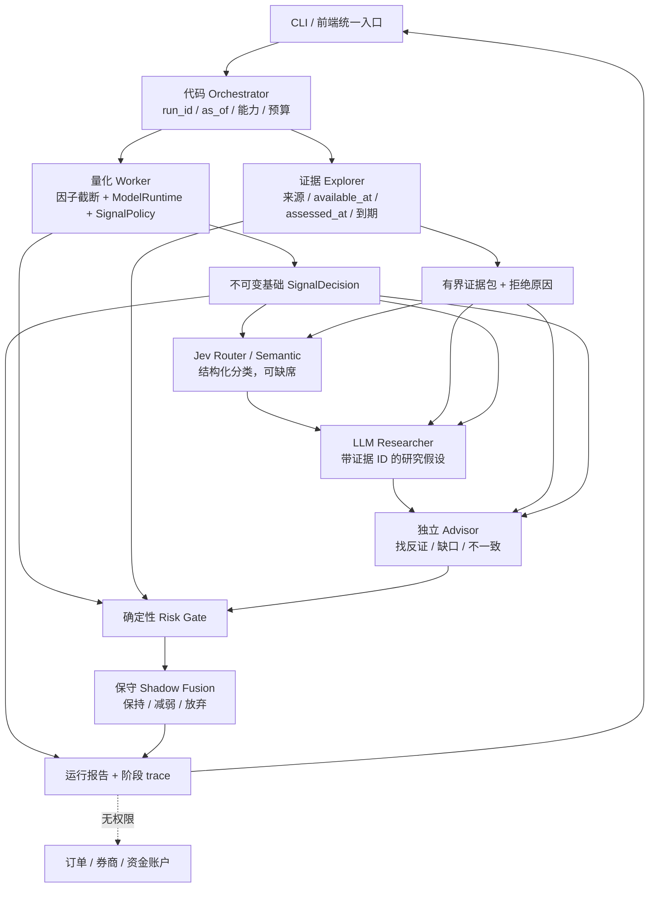

# 分层金融研究决策：视频思路核验、架构审计与实现方案

调研日期：2026-10-03；实现验收更新：2026-10-04（上海时间）。对象：F_Agent 的 TL 研究链路。本文区分「已核验来源」「整改前源码事实」「本轮实现」和「后续推广条件」。实现与离线验收不等于在线服务或金融效果已验证，交付状态见第 10 节。

## 1. 结论与证据边界

值得借鉴的是**分工、明确升级条件和程序控制的权限边界**，不是照搬视频中的模型组合或多开几个聊天窗口。项目已有数值模型、版本化策略、Jev 适配器和舆情事件库，下一步应把它们收敛为一个可追溯的研究运行时：量化路径给出唯一基础信号；证据路径按决策时点筛选；Jev 做有限分类；Researcher 解释，Advisor 反证；代码执行预算、风险检查与影子融合。任何研究角色都不取得订单权限。

### 视频能证明与不能证明的内容

用户提供的视频链接为 [微信视频页面](https://weixin.qq.com/sph/AUs1gooui0)。本任务前序浏览器读取到了页面简介，**没有取得完整视频、逐字稿、源码或可复现项目**。

简介描述了 Claude Code 主执行者、Advisor 在规划/重复错误/交付前介入、Jev 分发，以及 Explorer/Worker/Researcher 分工；出现的 Opus 5.5、Fable 5.1 是简介中的组合表述。由此只能确认作者描述了这种设计，不能确认视频内所有界面、配置、测试结果或实际部署情况。

以下结论保持「未知/未验证」：

- 是否存在与该视频对应的开源仓库、具体 commit、License 与复现说明。没有提供仓库，不以同名或相近项目冒充来源。
- 视频应用、界面、模型权重是否开源。能调用 API、存在公开文档、甚至存在 SDK，都不等于完整应用或模型权重开源。
- 毫秒级端到端响应、连续 24 小时可靠运行、成本收益和金融任务效果。没有本项目测量，不转述为已验证性能。
- 本地账户是否有视频所用模型的访问资格，以及接口、价格、配对限制是否适合本项目。

因此本文不是复刻视频项目的教程，而是**借鉴其角色协作思想，对 F_Agent 做独立工程设计**。

## 2. 官方资料核验

本节仅用官方页面；文档可访问不是本地配置成功，也不是免费或开源许可证明。页面内容可能更新，生产实现应固定模型、协议和本地 schema 版本。

| 官方资料 | 可核验事实 | 本项目如何采用 |
| --- | --- | --- |
| [TypeSafe Introduction](https://docs.typesafe.ai/introduction) | Jev 面向给定状态的结构化问题；提供 Choice、Score、Noul，复杂判断可拆成原子问题后由代码组合 | 不把 Jev 当数值收益预测器或无约束总指挥；保留数值模型 |
| [TypeSafe Choice](https://docs.typesafe.ai/primitives/choice) | Choice 返回选项、各选项概率和 confidence；API 使用 `state/model/questions`，答案以问题 ID 对应 | 固定类别及未知项，校验枚举、范围、分布；低置信度拒绝自动升级权限 |
| [TypeSafe Intent routing](https://docs.typesafe.ai/patterns/intent-routing) | 分类可路由至确定性代码、专用 LLM 或人工；示例由代码解释结果 | Jev 只建议研究路径，程序决定能否、何时、花多少预算调用 |
| [Claude Code Subagents](https://code.claude.com/docs/en/sub-agents) | 子代理有独立上下文，可配置提示、模型与工具权限，并向主流程返回结果 | 借鉴角色隔离，不要求把运行中的金融应用依赖于 Claude Code CLI |
| [Claude Code Advisor](https://code.claude.com/docs/en/advisor) | Advisor 为实验功能，适合复杂任务中的关键节点；配置和可用配对受产品/账户约束 | 将独立审查做成可替换角色，不写死简介中的型号；不因增加 Reviewer 就宣称正确性提高 |
| [Claude Platform Advisor tool](https://platform.claude.com/docs/en/agents-and-tools/tool-use/advisor-tool) | 原生 advisor 是服务端独立推理、无工具，可接收执行者完整上下文；`max_uses` 是单请求上限，需另控整个会话预算 | 当前先做应用层可审计的 Advisor 角色；接原生协议属于独立适配工作，不把普通第二次 LLM 调用冒称原生 Advisor |

关键区别：**Claude Code 子代理、Claude 服务端 Advisor、项目内 Researcher/Advisor 类是三个不同层级的机制。** 本项目可以实现相同的职责分离，但不能据此声称接入了尚未适配、未验证的产品能力。原生 Advisor 的数据传输、返回形态和计费需按官方协议单独评估；不要未经检查把完整历史、敏感原文或凭证交给任何外部角色。

本次没有核验上述模型的权重 License，也没有找到视频对应仓库的 License，均记为未知；不会把「可借鉴的架构思想」写成「可直接复用的开源代码」。

## 3. 本地架构审计：保留已有边界，修补穿透路径

以下是本轮改造开始时的源码状态；指出的是入口与数据契约缺口，不代表这些模块全部需要重写。文件引用为仓库相对路径，便于在其他机器复核。

### 已有资产

- [`ResearchAgent`](../src/research_agent.py) 已有单轮编排、`run_id`、阶段状态、可注入运行时，以及基础决策与研究建议分离。量化输入是 `outputs/df_factors.pkl`。
- [`ModelRuntime`](../src/strategy_runtime.py) 做只读模型推理，`SignalPolicy` 根据版本化策略产生决策，包含策略指纹、release 与 decision 标识。它们应继续成为唯一基础方向/权重来源。
- [`SignalFusionEngine`](../src/signal_fusion.py) 已拒绝研究层修改可执行方向/仓位，并将调整记录为 shadow proposal。它不是下单接口。
- [`JevClient`](../src/jev_client.py) 已支持 `off/cache/online`、固定版本、结构化响应校验与内容寻址缓存；已有文档语义特征及影子风险判断。
- [`IntelligenceStore.query_assessments`](../src/intelligence_events.py) 已按文档可用时间、评估时间、失效时间和当时可见修订筛选事件。这是严格时间检索的可复用基础，而不是从零再建另一套事件库。

### 确认的缺口与整改目标

| 缺口 | 改造前证据 | 风险 | 本轮目标 |
| --- | --- | --- | --- |
| 多入口与 UI 状态分叉 | [`dashboard_v2.py`](../src/dashboard_v2.py) 的融合按钮直接调用 `run_fusion` 并单独保存 `fused_signal`；另有 ResearchAgent 周期 | 上一轮信号/证据可被下一轮页面误展示，独立按钮绕过统一预算/trace | 前端薄入口调用统一研究运行时；展示以 `run_id`、`decision_id` 和 as-of 绑定的单次结果 |
| 「不调用 LLM」不是全链路离线 | `SignalFusionEngine.fuse` 的 `use_llm` 只门控最后推理，RAG/Jev 分支另有开关；`run_fusion` 可构造带 API key 的 RAG，`RAGAnalyzer.query` 有 key 即生成答案 | 使用者关掉 LLM 仍可能联网、计费或发送内容 | 不把 `use_llm=False` 当局部提示；全路径显式能力开关，调用前硬检查，离线模式跨适配器零网络 |
| freshness 只处理部分失败回退 | `ResearchAgent.run_cycle` 对因子重建失败提供 stale-fallback 开关，但复用旧文件时没有统一最大年龄与未来时间门禁 | 旧因子被当作当前基础信号，或未来行参与当前计算 | as-of 截断先于推理；独立 freshness 判定；不把文件存在等同数据可用 |
| 事件摘要可能混入未来证据 | ResearchAgent 展示路径读 `recent_event_records` 和最近 assessments，未以基础决策时点约束 | 当前抓取到的修订/新评估污染过去决策的解释 | Explorer 使用严格可见性过滤，输出已接受与拒绝证据及原因 |
| RAG 的 as-of 契约尚不充分 | [`RAGAnalyzer._metadata_visible_as_of`](../src/rag_tool.py) 已过滤发布字段，但没有统一要求系统实际可用时间 | 把「早发布、晚取得」材料当成当时已知；候选检索/生成边界不一致 | 新研究链路只使用可证明当时可用的证据；旧宽松 RAG 不作为隐式 fallback |
| Shadow 仍可能产生难解释提案 | 旧融合规则可以形成反向或加仓 proposal，再恢复基础方向/仓位 | 研究建议难评估，UI 易误读为可执行建议 | 新 shadow 仅允许保持/减弱/放弃；基础 signal 原样保留 |
| 缺少统一请求预算和阶段契约 | LLM、RAG、Jev 各自调用；没有统一 Researcher/Advisor 协议及失败 trace | 重复调用、隐性重试和不可复现的结果组合 | 一个代码 orchestrator 管阶段、预算、超时、状态和最终权限 |

`persist=False` 也需要明确范围：不保存最终报告不等于所有下层初始化、抓取、缓存、索引或通知都没有副作用。本轮的新 runtime 应做到该模式下不写研究产物；若上层显式请求因子重建或采集，必须把那些独立副作用单独声明，不能给出误导性的「完全只读」保证。

### 宏观、微观和文本判断不是同一种量

已有 [`HierarchicalMacroMicroModel.components`](../src/hierarchical_model.py) 的数值组合为 `prediction = micro_alpha * gate_weight + macro_state`；`event_alpha` 只用于诊断，不是再次相加的一项。`ModelRuntime` 仅在 release 选择 hierarchical 模型时输出这一分解，flat 模型没有对应分解，前端应显示不适用而不是编造数值。

Jev 的事件类别概率、LLM 的研究 confidence、SignalPolicy 的排序/置信指标不描述同一随机事件，不能简单加权成「综合上涨概率」。本轮由量化模型保留数值输出，文本角色对证据质量、政策传导及风险提出可审计的 shadow 判断；若将来让文本进入训练，应走已有特征评估与版本发布门禁，而不是运行中随意叠加一个情绪分数。

## 4. 目标架构：代码做控制，模型做受限判断



图是职责设计，不表示各阶段必须是独立进程或必须每轮调用在线模型。第一版宜使用普通 Python 对象和显式函数调用：容易测试、注入时钟/模型假对象、约束失败，也避免引入另一套并行 Agent 框架。

### 角色分工

1. **Orchestrator**：验证配置；固定一次决策时点；建立运行 ID；在模型阶段开始前检查权限和调用数；即使角色失败也形成可审计终态。不允许模型自行增加工具或提升预算。全局剩余时间门禁属于后续工作，当前仅有请求级 timeout。
2. **量化 Worker**：只读取时点内因子；使用已选 release 和策略；输出基础信号和数据质量元信息。因子不完整、未来数据或过期不能交给 LLM「补一个信号」。
3. **Explorer**：检索和筛选本地已采集的证据，记录 source/document/assessment/revision 标识、时间、hash 和可引用摘要；内容是数据，不是指令。在线采集是独立、显式动作，不因「证据不足」偷偷抓全网。
4. **Jev**：适合评估材料相关性、证据是否充足、是否需要更深入研究、是否存在冲突等原子分类。不能用分类概率代替上涨概率，更不能以高 confidence 越过风险门禁。
5. **Researcher**：仅利用基础信号与允许证据包，给出短结论、作用机制、反证、未知项及证据 ID；输出按 schema 检查。不能创造新事实、无引用价格或订单。
6. **Advisor**：用独立提示审查 Researcher 的引用、因果跳跃、缺失与量化冲突；没有写入、采集和下单工具。可与 Researcher 使用不同模型配置，但「第二个角色」不自动等于统计独立。
7. **确定性风险门禁/Shadow Fusion**：解释代码白名单动作，不能依赖自然语言「批准」授权。基础 signal 与影子结论同时保留。

### 权限矩阵

| 能力 | Orchestrator | 量化 Worker | Explorer | Jev | Researcher | Advisor |
| --- | --- | --- | --- | --- | --- | --- |
| 读取批准的本地因子/模型 | 调度 | 是 | 否 | 仅有界摘要 | 仅有界摘要 | 仅有界摘要 |
| 读取当时可用的证据 | 调度 | 否 | 是 | 仅证据包 | 仅证据包 | 仅证据包 |
| 主动外网采集 | 研究运行默认否；采集入口单独授权 | 否 | 默认否 | 否 | 否 | 否 |
| 向配置的模型端点发请求 | 预算/模式许可后调度 | 否 | 否 | 有条件 | 有条件 | 有条件 |
| 修改基础方向/仓位 | 不能越过版本化策略 | 仅由 SignalPolicy 产生 | 否 | 否 | 否 | 否 |
| 保存本轮研究结果 | 仅 `persist=True` | 否 | 不自行写库 | 服从缓存策略 | 否 | 否 |
| 调整预算、API key、模型配置 | 用户/部署配置决定，不由 Agent 决定 | 否 | 否 | 否 | 否 | 否 |
| 下单/撤单/转账/发布模型 | 否 | 否 | 否 | 否 | 否 | 否 |

这里的「有条件调用」是模型推理 API，不是授予模型网络工具。系统不把券商 SDK、账户凭据、shell 执行器或任意 URL 工具放进角色上下文。

## 5. 时间、可见性与持久化契约

### 5.1 一个 run，一个 as-of

运行启动就确定请求 cutoff；缺省使用显式时钟的当前时点，历史复盘必须传入历史 `as_of`。当前实现还区分 `requested_as_of` 和 `snapshot.as_of`：后者取 cutoff 内**最后一条可用因子**时点；证据以这个更保守的市场时点筛选，而不是把两者之间收到的新闻混入旧行情决策。内部统一时区；对于项目的无时区行情时间按上海时间解释，不能隐式当成 UTC。

- 因子在交给模型前先移除 `timestamp > as_of` 的行，再检查排序、有效值和至少需要的 warm-up 长度。
- 对证据要求有效的 `available_at <= as_of`；若声明 `published_at`，它也不得晚于 as-of。不能以发布日期替代实际可用时间。
- 对已有语义评估要求 `assessed_at <= as_of`，并检查 `expires_at`、修订可见性、撤回/隔离状态。缺时间、坏时间、未来修订应拒绝，不默认为「现在可用」。
- source 健康检查时间、文本的发布日期、采集时间和模型推理时间是不同字段。缓存生成晚于 as-of 的语义结论不能自动视为历史时点已知的结论。
- 当日新运行对旧文本做出的新分析可用于**当前**研究；若用于历史回测，应显式标记为事后重新解释，而不是伪称当时已运行的 Agent。

freshness 与 as-of 是两个检查：证据虽不来自未来，也可能过期。门槛应按输入类别配置，记录观测时间、age 和拒绝原因；节假日、非交易时间不能仅靠自然日差自动判断。当前实现的 `max_age_hours=24` 是当前自然时钟减最后因子时间，不是交易日历。节假日或历史复盘可能正常触发 `stale_market_snapshot`；保留研究结果，但最终状态 `blocked`。这不是已经识别了交易所休市，也不应通过随意扩大阈值把旧数据宣传为实时。

### 5.2 证据包最小格式

以下是设计契约，不是要求将所有字段原样直接传给外部模型：

```text
evidence_id / document_id / assessment_id / revision_id
source_name / source_url / content_hash
published_at / available_at / assessed_at / expires_at
title / bounded_excerpt / relevance / quality_flags
accepted_or_rejected / rejection_reason
```

缺省只发有界摘要和安全标识，保留引用追溯在本地；不上传原始全库、凭证、客户资料或订单信息。未知证据 ID、引用被剔除证据、来源文本中的代理指令都不能进入有效建议。

### 5.3 运行状态与文件

设计要求保留每次运行的 `run_id`、`as_of`、策略指纹、模型 release、基础 decision ID、模式与配置版本、证据 ID 集合、角色/模型标识、阶段状态和错误、预算消耗及最终 shadow 结论。日志是简洁状态和结构化理由，不要求记录隐藏思维链。

当前阶段状态是 `ok / skipped / unavailable / error / blocked`；被拒绝证据记录在 `evidence_exclusions`，整体研究结论为 `blocked / review_required / research_only`。空数据不是成功；缺 key 不是正常模型结论；返回缓存也必须标记。失败后的上一轮报告可以作为历史浏览，但不能冒充本轮成功。

当前 `persist=False` **仅关闭 hybrid 审计 JSON 的保存**；新研究入口本身不写交易记忆、训练模型或生产信号，但 online Jev 仍可写其内容寻址模型缓存。因此 online + `persist=False` 不是完整 dry-run。需要不发模型请求、不写研究产物时，使用 `network_mode="offline"` 并传 `persist=False`；cache 模式只读已有 Jev 缓存。以后如需要在线也完全无本地写入，须额外提供 adapter 级缓存写入开关，不能仅靠这个参数。重复 UI 渲染只读报告，不重跑 API；只有显式运行按钮创建新 run。

## 6. 模式、预算和失败降级

### 6.1 能力开关比提示词优先

| 模式/条件 | 网络与模型 | 允许输出 |
| --- | --- | --- |
| 纯离线研究 | 网络关闭，Jev/LLM/外部 Advisor 不调用；可做本地规则与已允许的只读检索 | 量化基础结果、证据覆盖和明确标注的规则 shadow |
| 缓存回放 | 只允许受版本/时间契约约束的已存结果；不能 cache miss 转 online | 可复现实验输出，包含命中/缺失状态 |
| 显式在线研究 | 有 key、允许的模型配置、剩余预算和时点内证据时才调用 | 有 schema 校验及来源引用的 shadow 研究结果 |
| 证据不足或基础输入不合格 | 不以语言模型猜测替代数据 | 阻断或放弃研究；展示缺口与原因 |

「缓存回放」是完整设计中的独立能力，不表示本轮已支持所有角色的持久缓存；未实现的模式不得仅因设置一个字符串就显示可用。默认应是离线或 shadow-only，不能默认开启连续后台调用。

### 6.2 全局预算

当前配置每轮默认最多 **4 次模型阶段尝试**：Jev Router、Jev Semantic、Researcher、Advisor 各至多一次。失败尝试也占额度；offline 直接跳过、不占在线模型尝试数；cache 下进入适配器的尝试也占额度。因此 `attempted_calls` 是有界阶段尝试计数，**不是精确 HTTP 次数或账单**。API key 缺失、缓存命中均可能不产生 HTTP。按需跳过胜于未审核的无限重试。

完整预算应覆盖：总请求次数、每阶段输入字符/证据数、每请求 timeout、输出 token 上限、整轮时间上限。当前 runtime 的硬门禁是阶段尝试数和证据数；adapter 另限有界输入、请求超时及 LLM 输出 token。**尚无整轮硬截止或金额硬上限**。字符上限不是 token 上限，更不是金额上限；完整费用控制还需版本化费率、供应商 usage 和失败计费规则。

后续若增加全局 deadline，应在阶段启动前检查并让 HTTP timeout 受剩余时间约束；同步依赖若不能被取消，也可能超过软截止。当前 `elapsed_ms` 是运行记录而非已测延迟 SLA。外部服务失败后不应静默切换到另一个付费供应商。

### 6.3 故障矩阵

| 故障 | 应有行为 | 禁止行为 |
| --- | --- | --- |
| 因子缺失/过期/未来数据 | 基础路径标记不可用或明确阻断研究；记录 cutoff 与失败字段 | 读旧 JSON 当当前信号、让 LLM 生成数值预测补位 |
| Explorer 无合格材料 | 记录证据空集、拒绝计数，影子建议保持保守或放弃 | 将最新材料回填到过去，使用未核验的发布日期冒充可用时间 |
| Jev 关闭/无 key/超时/坏响应 | 记录不可用；代码选择保守路径，不能伪造置信度 | 解析残缺 JSON 后继续当成高置信分类 |
| Researcher schema 或引用失败 | 拒绝角色输出；可保留确定性摘要与基础信号 | 使用自由文本正则抓取一个方向就宣称有效 |
| Advisor 不可用或发现反证 | 标记未审查/分歧；禁止升级风险；形成待复核提案 | 删除分歧、把 Researcher 复述当独立批准 |
| 全局预算耗尽 | 后续模型阶段 `skipped:budget`，仍形成终态报告 | 在 adapter 内额外无限重试 |
| 持久化失败 | 明确区分「内存结果已生成」与「报告未保存」 | 假称已落盘，替换已有有效报告为半文件 |
| 恶意源文本 | 文本视为不可信证据，过滤/隔离并记录 | 按网页或研报中的指令修改配置、读取密钥、下单 |

即使 Advisor 同意，shadow 融合也不得反转基础方向、扩大基础仓位，或把基础 flat 变成持仓。可用代码不变量表达：`proposal_weight <= base_weight`；proposal 方向只能是基础方向或 flat；`executable/base_signal` 保持不变。这是工程权限限制，不是投资建议或交易收益保证。

## 7. 本轮实施边界与去重路径

目标是新增一个小而明确的 `hybrid_runtime` 和模型角色适配层，ResearchAgent 与前端走同一入口；不重写数值模型、不重新训练、不改券商执行链路，不部署新的全天后台服务。

推荐迁移顺序：

1. 定义运行配置、角色结果和 trace schema；先锁定不联网、无写入与不改变基础交易状态的测试。
2. 将量化、证据筛选、Jev、Researcher、Advisor、风险 gate 串成可注入流程，覆盖缺数据和失败降级。
3. ResearchAgent 调用同一 runtime；保留旧接口兼容，明确历史 legacy fusion 不再是新页面的隐式决策旁路。
4. 前端仅配置和展示一次 run；原生 trading signal、shadow proposal、证据/模型状态分别展示，旧结果标记为历史。
5. 再评估旧 `SignalFusion` 入口的弃用或迁移，不能删除仍被其他功能使用的代码却声称已全面去重。

本轮角色调用是**应用层角色分工**。如果底层均使用同一个模型，报告要显示相同模型 ID，不能宣传为多模型委员会；如果仅 API/提示角色不同，也不能据此推断错误相互独立。未来接 Anthropic 原生 Advisor 时需独立协议 adapter、权限审查和回归测试。

## 8. 消融评估与推广门槛

不以一次看起来合理的解释、一个截图或单元测试通过证明交易有效。先做离线可重放质量验证，再做不交易的 shadow 对照。

### 对照组

| 组别 | 固定量化基础 | 新增模块 | 主要回答的问题 |
| --- | --- | --- | --- |
| A | 是 | 无 | 量化基线和已有规则的质量/成本 |
| B | 是 | 严格 Explorer + 确定性规则 | 改善来自证据质量还是模型生成 |
| C | 是 | B + Jev | 分类/升级路由是否比规则好，是否有校准问题 |
| D | 是 | B + Researcher | 有依据的研究解释是否改善人工评阅与缺口识别 |
| E | 是 | D + Advisor | 独立审查是否真正提高错误检出，而非只增加相同结论 |
| F | 是 | 全链路 | 预算、失败率、质量和延迟的综合权衡 |

冻结同一模型 release、策略版本、证据快照、as-of 分割和评价 rubric。不要在看到某次亏损后挑选更有利的新闻或调整阈值；训练/开发/封存测试集按时间分离，避免同源转载与修订跨集泄漏。

### 建议门槛：先登记，再测量

- **硬安全门槛**：未来证据进入率、未知引用接受率、基础方向/权重越权次数、离线外呼次数、预算越界次数均为 0；故障用例全部可追溯。
- **证据质量**：人工标注样本上的相关性、实体/事件/否定识别、引用支持率、漏掉反证的比例；明确样本数与分层，单独评估央行政策、供给、信用风险和流动性事件。
- **审查增益**：比较 D/E 的错误检出、误报和修复后新增错误，按运行配对；Advisor 同意率不是质量指标。
- **概率与拒答**：Jev/LLM 置信度不直接当金融概率；评估校准、coverage-risk 和低证据时 abstain 是否恰当。
- **运行指标**：端到端 p50/p95、外呼次数、token/费用、超时/空结果率、缓存命中率和人工复核耗时；不从供应商示例推断本机性能。
- **收益侧仅为后续实验**：先保持基础信号不变；若以后研究影子建议的经济价值，必须单独做有交易成本、滑点、滚动时序验证及稳定性区间的离线实验。不能因为叙事更好就接入实盘。

推广建议：功能通过离线硬门槛后才进行有上限的人工触发在线 smoke；之后收集不同市场状态的 shadow 运行，达到事先登记的样本量与质量/成本非劣标准，再决定是否扩大研究用途。**自动下单、调仓或模型发布始终是另一个需明确授权和风控审查的项目阶段**。

## 9. 启动示例与验证方式

当前已核对 [`src/hybrid_runtime.py`](../src/hybrid_runtime.py) 的公共 API 与默认值；以下是调用示例，实际执行范围及结果见第 10 节。

| 配置/API | 当前定义 |
| --- | --- |
| `HybridConfig.network_mode` | 默认 `offline`；枚举 `offline/cache/online` |
| `asset` | 仅 `TL`；其它资产明确拒绝，不借用 TL 因子 |
| `max_age_hours` | 默认 `24.0`，有限正数，按自然时钟计算 |
| `max_model_calls` | 默认 `4`，整数 `0..4` |
| `max_evidence` | 默认 `20`，整数 `1..20`；与模型证据条数上限一致，adapter 另对文本限长，超总输入预算则拒绝 |
| `run_hybrid_research` | 支持注入 `factors/runtime/policy/adapters/evidence_loader/now/on_event`，便于离线测试 |
| `persist` | 默认 `True`，保存独立研究审计结果，不写训练模型或 `trade_memory`；`False` 关闭审计保存，但 online Jev 缓存仍可写 |
| 产物 | `outputs/hybrid_runs/<unique_run_id>.json`；`schema_version=f_agent.hybrid.v1` |
| 历史读取 | `list_hybrid_runs(base_dir, limit=30)`、`load_hybrid_run(base_dir, run_id)` |

`run_id` 含时间与随机后缀；先完整写临时文件，再无覆盖地原子发布，重复 ID 不能覆盖旧结果。加载时校验路径/大小/schema/run_id，以及 `execution_authorized=False`。`persistence.status` 区分 `not_requested/saved/error`，不会将失败伪装为已保存。

trace 包括 `snapshot`、`baseline`、`evidence`、`evidence_exclusions`、`route`、`opinions`、`decision`、`stages`、`budget` 和 `persistence`；每阶段记录 ID、依赖、起止时间、耗时、状态、来源/模型、输出、原因和可用 usage。`advisor_plan` 是**本地规则计划检查**，不是额外在线 Advisor 调用；在线独立 Advisor 当前只在交付/失败复核阶段调用。不要据此宣传为完整复刻视频中的每个介入点。

```bash
# 从项目根目录查看当前实际 CLI，避免按过期文档猜参数。
.venv/bin/python src/main.py --help

# 统一入口：默认离线；不重建因子，不采集舆情，不保存本次审计文件。
.venv/bin/python src/main.py --mode hybrid --network-mode offline --no-persist \
  --question "当前国债期货信号有哪些支持与反对证据？"

# 若不加 --no-persist，则仅另保存独立研究审计 JSON。
# 可用 --as-of 指定历史 cutoff；旧快照触发 freshness blocked 并非运行失败。

# 直接使用新运行时：禁用外部模型调用，不保存本轮审计文件。
# 本地因子和已发布模型缺失/过期时，返回的 blocked 状态是有效安全结果。
PYTHONPATH=src .venv/bin/python - <<'PY'
from pathlib import Path
from hybrid_runtime import HybridConfig, run_hybrid_research

trace = run_hybrid_research(
    Path.cwd(),
    question="宏观与微观证据是否支持当前 TL 策略？",
    config=HybridConfig(network_mode="offline"),
    persist=False,
)
print(trace["run_id"])
print(trace["decision"])
print(trace["budget"])
PY

# 只启动前端本身，不代表启动后台轮询或交易。
.venv/bin/python -m streamlit run src/dashboard_v2.py --server.port 8503
```

已对读的统一入口为 [`ResearchAgent.run_hybrid_cycle`](../src/research_agent.py)，它代理同一个 runtime，不重建因子、更新交易记忆、发送通知或执行订单。[`main.py`](../src/main.py) 已接入 `--mode hybrid --network-mode offline/cache/online --question --as-of --no-persist`。hybrid 拒绝与 `--rebuild-factors` 组合；`--no-llm` 若同时使用，只能搭配 `--network-mode offline`，防止互相矛盾的开关。旧 `--mode research --no-llm` 的旁路风险不能因为新增了 hybrid 就自动宣称全部消除。

前端 [`hybrid_dashboard.py`](../src/hybrid_dashboard.py) 已被 `dashboard_v2.render_ai_fusion` 接入。默认离线，显式按钮触发一次运行；在线需另勾选有限快照外发与费用确认。每张结果卡使用同一个 report，修改控件后保留旧 run 并提示尚未应用，而不是替换部分字段；历史读取不重新调用模型。前端运行默认保存审计 JSON；舆情采集在独立折叠区，不改写已保存决策。阶段图采用纵向布局及状态颜色，完整依赖、耗时、来源、输出可以逐项展开。

当前 LLM adapter 使用标准库 HTTP 请求调用固定的 DeepSeek Chat Completions 端点，禁止重定向和隐式重试，不要求新增 SDK。Researcher/Advisor 分别可用 `F_AGENT_HYBRID_RESEARCHER_MODEL` 与 `F_AGENT_HYBRID_ADVISOR_MODEL` 配置，回退到 `DEEPSEEK_MODEL` / `deepseek-chat`；填写的模型必须由该端点实际支持，不能填一个视频中的其他供应商型号就认定接入成功。两角色默认可能是同一模型，提示职责不同但不保证错误独立。移动别名也不等于不可变模型版本，应在正式评估中固定可用版本并记录 provider 返回的模型标识。

cache 模式当前仅尝试 Jev 的只读缓存；未配置 LLM review 缓存时，Researcher/Advisor 返回 `unavailable`，不偷偷转为在线。完整历史输出回放应使用已保存 trace；不能把一次当前运行的缓存命中宣称为重现了整个历史运行。

任何在线运行需用户明确开启并配置所需凭据；凭据只通过部署环境/安全配置提供，不写入本文、命令历史截图、报告或 trace。本轮未发起真实远端模型请求；在线与故障契约用 fake transport 验证。

后续核对时必须覆盖：正常输入、无 key、全链路禁网、未来材料、缺时间材料、未来修订、过期因子、空证据、错误枚举/NaN、伪造引用、角色冲突、达到预算、持久化关闭/失败，以及前端切换基础决策后的旧结果失效。测试命令和实际通过数应以本轮真实输出记录，不在调研文档里预填成功数字。

当前已存在的回归文件可这样运行；这只是测试入口说明，不表示本文代替执行者宣称结果：

```bash
.venv/bin/python -m pytest tests/test_hybrid_runtime.py tests/test_hybrid_models.py \
  tests/test_hybrid_entrypoints.py tests/test_hybrid_dashboard.py -q
```

## 10. 本轮交付状态与尚待核对

实现已接入 ResearchAgent、CLI 与前端；保留旧调用接口，不增加生产下单权限。按 architecture-audit 技能审查了执行/展示/落盘三类故障，按 python-testing 技能先复现再修复边界缺陷，并通过以下验收。

| 验收范围 | 实际结果 |
| --- | --- |
| 全量 `pytest tests -q` 与新模块覆盖率 | 545 项通过；新 runtime、adapter、workbench 综合行覆盖率 95%（89% / 97% / 100%） |
| 真实 SQLite 事件库 | 历史市场时点只取当时已取得/评估的原修订，排除未来修订；数据库内容未改 |
| 本地 LightGBM 集成 | 微型合成数据模型接入真实 ModelRuntime + SignalPolicy，基础决策与直接调用一致；未保存/发布生产模型 |
| Adapter 边界 | fake transport 验证在线/离线/缓存、失败预算、非法类型与未知引用、禁止重定向及响应限长；未做真实 API smoke |
| 缓存一致性 | 相同市场快照不会因审计时钟变化失去缓存；问题/证据/市场时点/新鲜度变化仍改变请求身份 |
| 工作区真实只读诊断 | 因子 159,465 行，截至 2026-06-02 15:15 上海时间；10 阶段、0 模型外呼，状态 `blocked` |
| 文件副作用 | 对因子、交易记忆、参数及模型文件等 6 个现存文件比较前后 SHA-256，一次 `persist=False` 运行未改变它们 |
| CLI | `--mode hybrid --network-mode offline --no-persist` 成功返回可直接 JSON 解析的 stdout；banner 走 stderr；状态 `blocked`，未保存产物 |
| 浏览器 | 127.0.0.1:8503 实际运行离线诊断，保存一份独立审计，再刷新并只读加载同一 run；显示双重阻断原因、0/4 调用预算、完整阶段图与角色状态 |

本地当前阻断不是页面错误：`canonical_model_unavailable` 表示仅存在未纳入发布管理的旧 pickle，`stale_market_snapshot` 表示因子缓存已过期。没有为展示效果启用 legacy 模型、伪造证据、扩大时效阈值或重训/发布模型。浏览器验收仅新增 `outputs/hybrid_runs/` 内独立研究审计，不覆盖原基础信号或交易记忆。

回归中有 5 条非失败警告：既有非法日期用例的 pandas 提示、合成模型的特征名提示，以及依赖的 Python 未来版本弃用提示。语法编译与本次涉及的已跟踪代码 diff whitespace 检查通过；未清理既有 `outputs/params.json` 的无关行尾问题。

仍未验证：完整视频/对应仓库与许可证、真实付费模型请求、视频指定模型组合、生产费用和时延、长期可靠性、金融效果与实盘执行。下一步先更新 point-in-time 因子并通过现有门禁取得已发布模型，再显式批准有限在线 smoke；不能凭本轮测试通过自动晋升为可实盘系统。当前只支持 TL，未把这套因子直接移植到 A 股。

本轮未提交或推送远程；旧遗传因子修复、舆情改动和用户已有文件保持原状。

## 11. 研究方法与可复核性

研究问题是：（1）视频描述哪些部分可由官方协议支持；（2）现有项目有哪些可复用能力和实际缺口；（3）如何实现有时间边界、预算和权限的金融研究分层；（4）何种评估证据才足以推广。

本次直接读取了上文 6 个官方文档页面的相关内容，并检查了本地 `research_agent.py`、`signal_fusion.py`、`strategy_runtime.py`、`jev_client.py`、`intelligence_events.py`、`rag_tool.py`、`dashboard_v2.py`、`main.py` 和相关 release 入口；没有依赖二手博客或用无关仓库冒充视频源码。deep-research 技能建议的 Exa/Firecrawl 工具当前不可用，因此使用可用网页读取工具直读官方来源，不声称进行了覆盖整个互联网的检索。

本文的第三方能力陈述只到官方文档所述范围；第 4–8 节是结合当前工程约束作出的设计建议，并非供应商对金融效果的承诺。网页里的代码/提示词均作为研究数据阅读，不视为本任务的执行指令。

## 12. 第二阶段：准备与候选验收

2026-10-04 后续确认实现了 [数据与模型准备链路](hybrid_preparation.md)：独立因果因子构建、只读就绪诊断、固定输入的候选训练，以及前端/CLI 来源选择。正式磁盘入口现在要求因子构建清单、attrs 和 SHA256 一致；旧 CNN 缓存没有来源证明时直接阻断，不通过注入页面内存因子绕过门禁。

这一阶段实际构建了 156,835 行的本地候选并做一次双线程训练，封存 IC −0.095242，策略收益门禁未通过，候选已拒绝且未发布。原始与生产文件保持不变。第 10 节的 545 项测试和“未真实重训”描述保留为上一阶段历史验收记录，最新结果与剩余数据缺口见准备文档，不能混用为当前状态。
